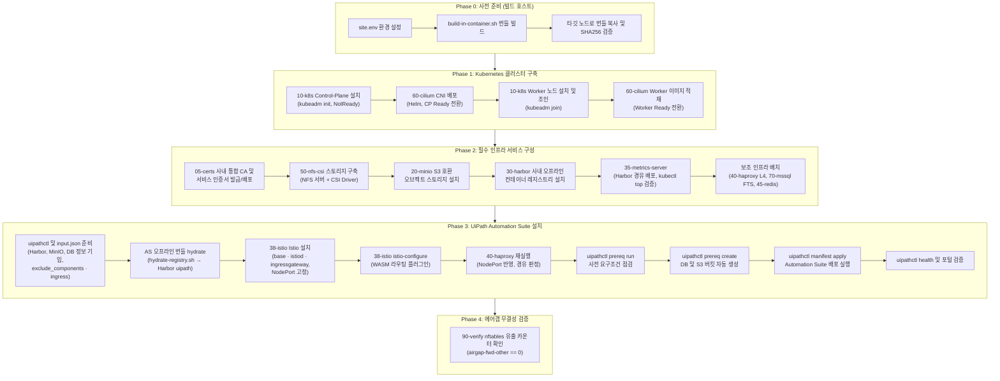

# offline-install — 에어갭 환경 Vanilla K8s 및 UiPath Automation Suite 오프라인 설치 가이드

인터넷에 연결되지 않은 완전 폐쇄망(Air-gapped) 환경의 Ubuntu 22.04 / 24.04 / 26.04 및 RHEL · Rocky 9 / RHEL 10 노드에 **Kubernetes v1.36.4** 클러스터를 구축하고, 그 위에 **UiPath Automation Suite(v2.2510.4)** 및 필수 인프라 서비스(NFS-CSI, MinIO, Harbor, HAProxy, MSSQL/PostgreSQL, Redis)를 단계별로 설치·운영하기 위한 종합 엔드투엔드 가이드입니다.

> [!NOTE]
> 저장소 루트의 `README.md`는 인터넷이 연결된 환경 기준의 온라인 설치 절차입니다.  
> 외부 인터넷 통신이 차단된 에어갭 환경에서는 반드시 이 문서의 오프라인 번들 기반 절차를 따라야 합니다.

---

## 1. 전체 아키텍처 및 단계별 설치 흐름

에어갭 환경의 구축은 단순 번호순이 아닌 엄격한 서비스 의존성에 따라 순차적으로 진행됩니다.



### 소프트웨어 버전 매트릭스

| 구성 요소 | 버전 | 유형 / 배포 방식 | 비고 |
|---|---|---|---|
| **OS** | Ubuntu 22.04 / 24.04 / 26.04 LTS, RHEL 9 (9.6) / 10 (10.2), Rocky 9 (9.8) | Linux Host (amd64) | 10-k8s 패키지 번들은 OS 별(코드네임 / el9 / el10), RHEL 은 빌드 호스트와 타깃의 부 버전이 같아야 함. RHEL 은 SELinux enforcing · firewalld 활성 상태로 검증 |
| **Kubernetes** | **v1.36.4** | deb / kubeadm, containerd v2.3.5 | CRI: containerd (`SystemdCgroup = true`) |
| **CNI (Cilium)** | **v1.20.2** | Helm 차트 + 컨테이너 이미지 | VXLAN tunnel (UDP 8472), kube-proxy 유지 |
| **Metrics Server** | **v0.9.0** | K8s 애드온 Manifest (`35-metrics-server`, 로컬 Harbor 경유) | `--kubelet-insecure-tls` 적용. 이미지 원본 `registry.uipath.com/rancher/hardened-k8s-metrics-server` |
| **인증서 (PKI)** | Internal CA | `05-certs/make-certs.sh` | OpenSSL 기반 사내 통합 CA 및 서비스별 SAN 인증서 |
| **Storage (CSI)** | csi-driver-nfs **v4.13.4** | K8s CSI Driver + NFS Kernel Server | 기본 StorageClass: `nfs-csi` (동적 프로비저닝) |
| **Object Storage** | MinIO `RELEASE.2025-09-07` | Docker Compose (SNSD 단일 노드) | S3 호환, TLS 적용. AGPL-3.0, quay.io 이미지 401(2026-10-17) |
| **Object Storage (대안)** | SeaweedFS **4.48** | Docker Compose (`weed server` 단일 노드) | Apache-2.0, S3 TLS 전용. 실서버에서 `install.sh` 판정 36/36 통과(4.3.1절). 사내 CA 인증서·브라우저 CORS 적용. AS 연계는 미검증. 판정 수정(`data_written`)을 더한 지금 코드는 미실행 |
| **Registry** | Harbor **v2.15.2** | 공식 오프라인 인스톨러 + systemd | HTTPS(443) 전용, 자동 복구 스크립트 |
| **Service Mesh (Istio)** | **1.30.3** (AS 2.2510.4 번들, Echo 재빌드 `1.30.3-20260730_echo`) / vendor/base·istiod·gateway **v1.30.3** | Helm 차트 (`38-istio`, hydrate 된 Harbor 경유) | UiPath 2.2510 [호환성 매트릭스](https://docs.uipath.com/automation-suite/automation-suite/2.2510/installation-guide-eks-aks/compatibility-matrix)와 AS 2.2510.4 번들의 버전. 이미지는 echohq.com 재빌드. [ISTIO-SECURITY-2026-006~009](https://istio.io/latest/news/security/) 수정은 upstream 1.30.8 에만 있고, Echo 재빌드 이미지에 2026-006~009 수정이 들어 있는지는 확인하지 못했습니다(미확인). 사용자가 이 위험을 알고 UiPath 배포 버전을 골랐습니다. 1.30 EOL 예정 2026-12경, k8s 1.32~1.36 지원([supported-releases](https://istio.io/latest/docs/releases/supported-releases/)). 다이제스트 고정. UiPath 래퍼 `helm/istiod` 대신 `vendor/istiod` 를 씁니다(렌더링 결과가 같음, 38-istio README 2.2절). `UIPATH_AS_VERSION` 을 바꾸면 Istio 값도 함께 바꿉니다(5.3.1절) |
| **L4 Load Balancer** | HAProxy **3.1** | Docker (`--network host`) | 80/443/15021 TCP 패스스루 |
| **Database** | SQL Server 2022 (CU25/CU26) / PostgreSQL 16 | Docker 커스텀 이미지 / Docker Compose | MSSQL은 **Full-Text Search(FTS)** 내장 필수, PG는 TLS 적용 |
| **Cache** | Redis OSS **7.4** | Docker Compose | TLS 활성화, 단일 노드 |
| **Embedding (선택)** | Ollama **0.40.13** + qwen3-embedding 8b (CPU Q4_K_M / GPU Q8_0), nginx **1.30.6** | Docker Compose (`85-ollama-embedding`, 단독 VM) | Bearer 키 1개 검사, OpenAI 호환 `/v1/embeddings` |
| **Automation Suite** | **v2.2510.4** | `uipathctl` 배포 | ArgoCD 기반 라이프사이클 관리 |

---

## 2. Phase 0: 사전 준비 (번들 빌드 및 사이트 설정)

오프라인 설치 번들은 인터넷이 되는 **빌드 호스트**에서 생성한 뒤, 에어갭 타깃 노드로 이관합니다.

### 2.1 사이트 환경 설정 ([`00-common/site.env`](file:///Users/hyungsoo.kim/Works/vanilla-k8s-as-install/offline-install/00-common/site.env))

사내 IP, 도메인, 스토리지 경로 등은 [`00-common/site.env`](file:///Users/hyungsoo.kim/Works/vanilla-k8s-as-install/offline-install/00-common/site.env) 파일에 정의합니다. 이 파일은 번들 생성 시 자동으로 포함됩니다.

```bash
cd offline-install/00-common
cp site.env.example site.env
vi site.env
```

**주요 설정 항목 요약:**
- `SITE_PRIVATE_CIDR`: 사내망 대역 (예: `10.32.99.0/24` 또는 `10.0.0.0/16`)
- `NFS_SERVER_HOST`: NFS 서버 호스트 IP (예: `10.32.99.4`)
- `NFS_MOUNT_PATH` / `NFS_EXPORT_PATH`: NFS 서버 마운트 및 export 디렉터리 (예: `/data/nfs`)
- `HARBOR_HOSTNAME` / `HARBOR_PRIVATE_IP`: 사내 Harbor FQDN 및 IP (예: `harbor.myrobots.co.kr` / `10.32.99.4`)
- `MINIO_HOSTNAME`: MinIO FQDN (예: `minio.myrobots.co.kr`)
- `WEED_HOSTNAME` / `WEED_HOST_IP` / `WEED_ROOT_USER` / `WEED_ROOT_PASSWORD`: SeaweedFS(MinIO 대안) S3 접속 FQDN·IP 및 자격증명. `05-certs` 가 `*.<WEED_HOSTNAME>` 와일드카드 인증서를 발급
- `WEED_DATA_DIR`: SeaweedFS S3 데이터 호스트 경로 (기본: `/data/weed`, 키가 없어도 이 값)
- `WEED_CORS_ORIGINS`: 브라우저가 SeaweedFS S3 를 직접 호출할 때 허용할 오리진(쉼표 구분, 예: `https://as.example.internal`). 비우면 `https://<AS_FQDN>` 을 씁니다. `*` 를 넣으면 `install.sh` 가 멈춥니다. `AS_FQDN` 도 비어 있으면 멈춥니다
- `AS_FQDN`: Automation Suite 서비스 FQDN (예: `as2510.myrobots.co.kr`, 하위 와일드카드 인증서 발급 대상)
- `MSSQL_DATA_DIR` / `MSSQL_SA_PASSWORD` / `MSSQL_PID`: 외부 MSSQL 데이터 경로, SA 암호 및 에디션
- `PG_DATA_DIR` / `PG_HOSTNAME` / `PG_PASSWORD`: 외부 PostgreSQL 데이터 경로(기본: `/data/postgresql`), 접속 FQDN 및 암호
- `REDIS_HOSTNAME` / `REDIS_PASSWORD` / `REDIS_PORT`: Redis 접속 FQDN, 패스워드 및 포트 (기본 6379)
- `MINIO_PORT` / `SEAWEEDFS_S3_PORT` / `POSTGRES_PORT` / `MSSQL_PORT`: 서비스별 호스트 노출 포트 (기본 9000 / 8333 / 5432 / 1433). 아래 "서비스 포트를 바꿀 때" 참고

#### 서비스 포트를 바꿀 때

`site.env` 의 포트 변수는 **호스트에 노출하는 포트만** 바꿉니다. 컨테이너 안의 포트, healthcheck, 설치 스크립트가 `docker exec` 로 붙는 포트는 기본값 그대로입니다. 키를 적지 않으면 `versions.env` 의 기본값(지금까지 쓰던 포트)이 쓰이므로, 기존 `site.env` 로 다시 설치해도 결과가 같습니다.

| 변수 | 기본값 | 컨테이너 포트 | 반영되는 곳 |
|---|---|---|---|
| `MINIO_PORT` | 9000 | 9000 | `20-minio/install.sh`. 웹 콘솔은 9001 고정. 이미 설치된 서버에서 바꾸면 `/opt/minio/minio.env` 의 `MINIO_SERVER_URL` 포트만 고치고 `minio.env.bak.<시각>` 백업을 남깁니다 |
| `SEAWEEDFS_S3_PORT` | 8333 | 8333 | `21-seaweedfs/install.sh`. 2026-11-06 `charles-weed` VM 에서 CORS 추가 전 코드로 28333 으로 바꿔 설치해 확인했습니다(`21-seaweedfs/README.md` 7절) |
| `POSTGRES_PORT` | 5432 | 5432 | `80-postgresql/install.sh` |
| `MSSQL_PORT` | 1433 | 1433 | `70-mssql/install.sh` |
| `REDIS_PORT` | 6379 | 6379 | `45-redis/install.sh` |
| `OLLAMA_EMBED_PORT` | 80 | 80 | `85-ollama-embedding/install.sh` |

Harbor 는 포트 변수가 없습니다. HTTPS 443 고정이며 HTTPS 로만 사용합니다(4.4절).

포트를 기본값에서 바꾸면 아래도 운영자가 함께 맞춥니다. 설치 스크립트는 이것들을 고치지 않습니다.

1. **번들 다시 만들기**: 빌드 호스트의 `site.env` 를 고치고 해당 번들을 다시 빌드합니다. 타깃에서 번들 안의 `site.env` 를 고치면 `install.sh` 첫 단계의 무결성 검사(`SHA256SUMS`)에서 멈춥니다.
2. **AS `input.json`** (5.1절)
   - MinIO / SeaweedFS: `external_object_storage.port`
   - SQL Server: `sql.port`. 연결 문자열 템플릿을 쓰면 `sql_connection_string_template`(`Server=tcp:<host>,<포트>`)와 `sql_connection_string_template_sqlalchemy_pyodbc`(`@<host>:<포트>/`)의 포트도 바꿉니다. `sql_connection_string_template_jdbc`(`jdbc:sqlserver://<host>;`)와 `sql_connection_string_template_odbc`(`SERVER=<host>;`)는 포트를 적지 않으면 1433 으로 붙으므로 `jdbc:sqlserver://<host>:<포트>;`, `SERVER=<host>,<포트>;` 처럼 포트를 넣습니다.
   - PostgreSQL: `postgresql.port`, `postgresql_connection_string_template_sqlalchemy_pyodbc` / `_asyncpg` 의 `@<host>:<포트>/`
3. **클라이언트**: `mc alias`, 저장소 루트 `minio-client/mc-client.yaml` 의 `MC_URL`, 앱의 연결 문자열(SQL Server 는 `<host>,<포트>`, PostgreSQL 은 `<host>:<포트>`)
4. **네트워크**: 클라우드 보안그룹·NSG, 상위 방화벽·LB 규칙. 대상 `install.sh` 는 호스트 방화벽(firewalld/ufw)을 건드리지 않습니다.

> [!NOTE]
> 기본값이 아닌 포트로 실제로 설치해 확인한 것은 SeaweedFS(`SEAWEEDFS_S3_PORT=28333`, 2026-11-06 `charles-weed` VM, CORS 추가 전 코드)뿐입니다. 나머지는 문법 검사와 템플릿 렌더링 검사까지만 했습니다.

### 2.2 컨테이너 환경에서 번들 빌드

깨끗한 호스트 환경을 보장하기 위해 rootless Podman 기반의 컨테이너 빌드를 권장합니다.

```bash
cd offline-install

# 1) 업스트림 다운로드 URL 생존 확인
./00-common/verify-urls.sh

# 2) 번들 빌드 실행 (Ubuntu 24.04 기준 전체 빌드, 85-ollama-embedding 포함)
./00-common/build-in-container.sh 24.04 all

# 특정 컴포넌트만 빌드할 경우 예시:
# ./00-common/build-in-container.sh 24.04 10-k8s 60-cilium 50-nfs-csi 30-harbor 20-minio
# MinIO 대안(SeaweedFS) 번들만:
# ./00-common/build-in-container.sh 26.04 21-seaweedfs
# SQL Server(FTS) 번들만 (호스트 Docker 로 빌드해 FTS 포함 확인):
# ./00-common/build-in-container.sh 24.04 70-mssql
# Ollama 임베딩 번들만 (호스트 Docker 로 빌드):
# ./00-common/build-in-container.sh 24.04 85-ollama-embedding
# Istio(38-istio) 번들만 (운영 번들, 이미지 없음):
# ./00-common/build-in-container.sh 24.04 38-istio
# 단일 노드 검증용 이미지 묶음까지 (--source local 용):
# ISTIO_LOCAL_IMAGES=1 ./00-common/build-in-container.sh 24.04 38-istio
```

빌드 컨테이너(`ubuntu:<버전>`)에는 docker 가 없습니다. 대부분의 단계는 이미 있는 것을 내려받아 tar 로 묶기만 하므로 docker 데몬이 필요 없습니다. 이미지는 skopeo 가 레지스트리에서 파일로 바로 받습니다(`docker://`, `docker-archive:` 는 skopeo 의 전송 형식 이름이고 docker 데몬과 관계가 없습니다). 단계별 실행 위치는 다음과 같습니다.

| 단계 | 실행 위치 | 이미지·파일을 얻는 방법 | docker 데몬 |
|---|---|---|---|
| 10-k8s, 20-minio, 21-seaweedfs, 30-harbor, 35-metrics-server, 38-istio, 40-haproxy, 50-nfs-csi, 60-cilium, 80-postgresql | podman 빌드 컨테이너 | skopeo(이미지), apt(deb), curl(바이너리·차트·인스톨러), helm(차트 pull, 38-istio) | 필요 없음 |
| 45-redis | 컨테이너에서 빌드할 단계가 45-redis 하나뿐이면 호스트에서 바로 실행(podman 안 씀). 아니면 빌드 컨테이너 | skopeo | 필요 없음 |
| 70-mssql | 호스트 Docker 를 쓸 수 있으면 호스트(컨테이너 단계 뒤). 아니면 빌드 컨테이너 | skopeo(게시된 `mssql-fts` 이미지, 다이제스트 고정). 이미지는 빌드하지 않음 | 받은 이미지의 FTS 포함 확인에만 씀 |
| 85-ollama-embedding | 호스트 Docker(컨테이너 단계와 70-mssql 뒤) | `docker build`(모델을 이미지에 넣음), skopeo(nginx) | 필요 |

> [!NOTE]
> `70-mssql` 과 `85-ollama-embedding` 은 podman 컨테이너가 아니라 **빌드 호스트의 Docker** 로 빌드합니다. 빌드 컨테이너에는 docker 데몬이 없기 때문입니다. 컨테이너 단계가 모두 끝난 뒤 호스트에서 70-mssql, 85 순서로 실행하고, 컨테이너 단계가 실패해도 실행합니다. 호스트에서 실행하므로 OS 인자(`24.04` 등)의 영향을 받지 않습니다. `all` 에는 선택 컴포넌트 `85-ollama-embedding` 도 들어 있습니다.
>
> - **70-mssql**: 이미지는 빌드하지 않고 게시된 `docker.io/javaos74/mssql-fts` 를 skopeo 로 다이제스트 고정해 받습니다. docker 는 받은 이미지에 FTS 가 들어 있는지 확인(`docker load` 후 `docker run --entrypoint dpkg ... -l mssql-server-fts`)할 때만 씁니다([70 README](file:///Users/hyungsoo.kim/Works/vanilla-k8s-as-install/offline-install/70-mssql/README.md) 3·4절). FTS 가 없으면 번들을 만들기 전에 실패합니다.
>   - 빌드 호스트 요건은 Linux x86_64, Docker Engine, skopeo 입니다.
>   - 호스트 Docker 나 호스트 skopeo 를 쓸 수 없으면 `WARN` 으로 원인과 조치를 출력하고 예전처럼 빌드 컨테이너에서 빌드합니다. 이때는 FTS 포함 확인만 건너뛰고 번들 tar 와 sha256 은 만들어집니다. 종료 코드에 영향이 없습니다. 끝에 `[SKIP] 70-mssql FTS 포함 확인` 이 다시 나옵니다.
>   - 확인을 위해 `docker load` 한 이미지가 호스트 Docker 에 남습니다. 지우려면 `docker image rm docker.io/javaos74/mssql-fts:2022-16.0.4265.3` 을 실행합니다.
> - **85-ollama-embedding**: 이미지 빌드 중에 `ollama serve`·`ollama pull` 로 모델을 넣습니다([85 README](file:///Users/hyungsoo.kim/Works/vanilla-k8s-as-install/offline-install/85-ollama-embedding/README.md) D2). 호스트에서 `85-ollama-embedding/build-bundle.sh all`(CPU 번들 + GPU 번들)을 실행합니다.
>   - 빌드 호스트 요건은 Linux x86_64, Docker Engine + buildx, RAM 16GB 이상, 디스크 약 80GB 입니다(85 README 3절). 이 단계만으로 약 23분이 더 걸립니다(85 README 3절 실측 1359초). Ollama 번들이 필요 없으면 `all` 대신 단계를 나열합니다.
>   - 그래도 호스트 Docker 를 쓸 수 없으면(Docker 미설치, 데몬 정지, sudo 불가, Linux x86_64 아님) `WARN` 으로 원인과 조치를 출력하고 85 만 건너뜁니다. 나머지 단계는 그대로 빌드합니다. 종료 코드는 `all` 이면 영향이 없고, `85-ollama-embedding` 을 단계로 직접 지정했으면 1 입니다.
> - 70-mssql 이나 85 를 빌드할 때 실행 계정이 docker 를 쓸 수 없으면, 빌드 시작 때 한 번 docker 그룹 권한을 구성합니다. 이미 docker 그룹 회원인데 지금 세션에만 그룹이 없으면(그룹 추가 전에 연 셸이나 tmux) 아무것도 바꾸지 않고 `sg docker` 로 실행합니다. 이때 번들 파일의 그룹은 `docker` 가 됩니다. 회원이 아니면 `sudo usermod -aG docker <계정>` 을 실행합니다. **docker 그룹은 root 와 같은 권한입니다.** 터미널이 아닌 곳에서 실행하면 sudo 암호를 묻지 않습니다(`sudo -n`).
> - 45-redis 와 70-mssql 만 지정하고 호스트 Docker 를 쓸 수 있으면 컨테이너 단계가 45-redis 하나만 남으므로 45-redis 도 podman 없이 호스트에서 빌드합니다.

> [!IMPORTANT]
> `10-k8s` 번들은 OS 의존적(deb 패키지)이므로 타깃 노드와 동일한 Ubuntu 버전(22.04 또는 24.04)에서 빌드해야 합니다. 나머지 번들은 컨테이너 이미지와 정적 파일 중심이므로 공용으로 사용 가능합니다.

### 2.3 에어갭 타깃 노드로 번들 전송 및 검증

생성된 `.tar.gz` 아카이브와 `.sha256` 체크섬 파일을 타깃 노드로 복사하고 무결성을 확인합니다.

```bash
# 타깃 노드에서 무결성 검증
sha256sum -c k8s-1.36.4-noble.tar.gz.sha256
sha256sum -c cilium-1.20.2.tar.gz.sha256
sha256sum -c nfs-csi-v4.13.4.tar.gz.sha256
sha256sum -c harbor-v2.15.2.tar.gz.sha256
sha256sum -c minio-RELEASE.*.tar.gz.sha256
sha256sum -c seaweedfs-4.48.tar.gz.sha256      # SeaweedFS 를 쓰는 경우
sha256sum -c istio-1.30.3.tar.gz.sha256        # 38-istio 운영 번들 (이미지 없음, 약 190KB)
# sha256sum -c istio-local-images-1.30.3.tar.gz.sha256   # 단일 노드 검증(--source local)에만 씁니다
```

`istio-local-images-1.30.3` 은 `ISTIO_LOCAL_IMAGES=1` 로 빌드할 때만 생기는 검증용 이미지 묶음(약 200MB)입니다. 운영과 다중 노드에서는 옮기지 않습니다. Istio 이미지는 5.2절 hydrate 로 Harbor 에 올라갑니다.

---

### 2.4 OS 계열 분리 계층 ([`00-common/os/`](file:///Users/hyungsoo.kim/Works/vanilla-k8s-as-install/offline-install/00-common/os/detect.sh))

OS 마다 달라지는 부분(패키지 관리자, CA 신뢰 저장소, 패키지 이름)은 `00-common/os/` 에 모았습니다. 단계 스크립트는 `pkg_installed`, `pkg_install_bundle_dir`, `ca_trust_update` 같은 공통 함수만 호출합니다. RHEL 계열을 추가해도 단계 스크립트를 복제하지 않기 위한 구조입니다.

| 파일 | 역할 |
|---|---|
| `os/detect.sh` | `/etc/os-release` 로 `OS_FAMILY`(debian / rhel / unknown) 판별, 인터페이스 정의, 계열 파일 로드 |
| `os/debian.sh` | Ubuntu 구현 (apt / dpkg / `update-ca-certificates`) |
| `os/rhel.sh` | RHEL 9/10 구현 (번들을 로컬 저장소로 dnf 설치, `update-ca-trust`, firewalld 포트, SELinux 레이블 복원, RHEL 10 `kernel-modules-extra`) |
| `10-k8s/pkgs-debian.sh` | 10-k8s 번들의 deb 수집(빌드 전용) |
| `10-k8s/pkgs-rhel.sh` + `rpm-closure.py` | 10-k8s 번들의 rpm 수집(빌드 전용, RHEL 9 호스트에서) |

- 모든 번들의 `00-common/` 에 `os/` 가 함께 들어갑니다.
- 구현이 없는 계열에서 OS 기능을 호출하면 `이 OS 에서는 아직 지원하지 않는 기능: <함수>` 로 중단합니다.
- macOS 관리 호스트처럼 `/etc/os-release` 가 없는 곳에서도 `common.sh` 는 읽힙니다(`OS_FAMILY=unknown`). `make-certs.sh` 처럼 OS 와 무관한 스크립트는 그대로 동작합니다.
- RHEL 9.6 / 10.2 에서 10-k8s · 60-cilium · 05-certs, Rocky 9.8 에서 여기에 30-harbor · 35-metrics-server 까지 검증했습니다(10-k8s README 3절). 나머지 20·40~80 단계는 RHEL 계열에서 아직 검증하지 않았습니다. RHEL 번들은 컨테이너가 아니라 RHEL 9 빌드 호스트에서 직접 만듭니다.

---

## 3. Phase 1: Kubernetes 클러스터 구축 (k8s Installation)

### 3.1 Control-Plane 노드 설치 ([`10-k8s`](file:///Users/hyungsoo.kim/Works/vanilla-k8s-as-install/offline-install/10-k8s/README.md))

Control-Plane 노드(예: `10.32.99.3`)에서 Kubernetes 기본 패키지, containerd 런타임, 정적 파드 이미지를 로드하고 `kubeadm init`을 실행합니다.

```bash
# Control-Plane 노드에서 실행
tar xzf k8s-1.36.4-noble.tar.gz
cd k8s-1.36.4-noble

# 단일 Control-Plane 설치
sudo ./install.sh

# HA 다중 Control-Plane 구성인 경우 (안정적인 VIP/LB 엔드포인트 지정 필수):
# sudo ./install.sh --control-plane-endpoint k8s-api.example.internal:6443
```

**설치 후 확인사항:**
```bash
export KUBECONFIG=/etc/kubernetes/admin.conf
kubectl get nodes
```
> [!NOTE]
> CNI가 아직 배포되지 않았으므로 노드 상태가 `NotReady`로 표시되는 것이 정상입니다.

---

### 3.2 Cilium CNI 설치 ([`60-cilium`](file:///Users/hyungsoo.kim/Works/vanilla-k8s-as-install/offline-install/60-cilium/README.md))

노드 간 네트워크 통신과 파드 간 라우팅을 활성화하기 위해 Control-Plane에서 Cilium CNI를 설치합니다.

```bash
tar xzf cilium-1.20.2.tar.gz
cd cilium-1.20.2

# Control-Plane에서 Helm 기반 CNI 설치 실행
sudo ./install.sh
```

**설치 검증:**
```bash
# 노드가 Ready 상태로 전환되었는지 확인
kubectl get nodes

# Cilium 파드 및 CoreDNS 정상 기동 확인
kubectl -n kube-system get pods -l k8s-app=cilium
kubectl -n kube-system get pods -l k8s-app=kube-dns
```

> [!WARNING]
> 오프라인 환경에서는 `docker-archive` tarball 임포트 시 이미지 다이제스트 매핑이 누락될 수 있으므로, [`60-cilium/conf/values.yaml`](file:///Users/hyungsoo.kim/Works/vanilla-k8s-as-install/offline-install/60-cilium/conf/values.yaml)에 `useDigest: false`가 반드시 유지되어야 합니다.

---

### 3.3 Worker 노드 설치 및 클러스터 조인 ([`10-k8s`](file:///Users/hyungsoo.kim/Works/vanilla-k8s-as-install/offline-install/10-k8s/README.md))

1. **Control-Plane 노드에서 조인 명령 발급:**
   ```bash
   sudo ./install.sh --print-join-command
   # 출력 예시: kubeadm join 10.32.99.3:6443 --token <TOKEN> --discovery-token-ca-cert-hash sha256:<HASH>
   ```

2. **Worker 노드(예: `10.32.99.4`)에서 조인 실행:**
   ```bash
   tar xzf k8s-1.36.4-noble.tar.gz
   cd k8s-1.36.4-noble

   sudo ./install.sh --role worker \
     --join-command "kubeadm join 10.32.99.3:6443 --token <TOKEN> --discovery-token-ca-cert-hash sha256:<HASH>"
   ```

---

### 3.4 Worker 노드 CNI 이미지 로드 ([`60-cilium`](file:///Users/hyungsoo.kim/Works/vanilla-k8s-as-install/offline-install/60-cilium/README.md))

Worker 노드가 클러스터에 조인되면 Cilium DaemonSet 파드가 스케줄링되지만, 폐쇄망에서는 이미지를 pull할 수 없어 `ImagePullBackOff`가 발생합니다. Worker 노드에서 CNI 이미지를 로컬 containerd에 미리 적재해야 합니다.

```bash
# Worker 노드에서 실행
cd ~/cilium-1.20.2
sudo ./install.sh --role worker
```

**클러스터 전체 노드 상태 확인 (Control-Plane에서 실행):**
```bash
kubectl get nodes -o wide
# 모든 노드가 Ready 상태이고 내부 IP가 정상 표시되는지 확인
```

---

### 3.5 Metrics Server 애드온 배포 → Phase 2 의 Harbor 설치 뒤로 이동 ([`35-metrics-server`](file:///Users/hyungsoo.kim/Works/vanilla-k8s-as-install/offline-install/35-metrics-server/README.md))

UiPath Automation Suite의 설치 사전 점검(`uipathctl prereq run`)에 Metrics Server가 필요합니다. 에어갭에서는 매니페스트 기본 이미지(`registry.k8s.io`)를 받을 수 없으므로, **30-harbor 를 설치한 뒤** 이미지를 로컬 Harbor에 올리고 그 주소로 배포합니다(4.4.1절).

---

## 4. Phase 2: Automation Suite 필수 인프라 구성 (Prerequisites / Infra Services)

Automation Suite 설치 전, 스토리지(NFS-CSI), 오브젝트 스토리지(MinIO), 사내 레지스트리(Harbor), 로드밸런서(HAProxy), 데이터베이스(MSSQL/PostgreSQL), 캐시(Redis)를 구성합니다.

### 4.1 사내 통합 CA 및 서비스 인증서 발급/배포 ([`05-certs`](file:///Users/hyungsoo.kim/Works/vanilla-k8s-as-install/offline-install/05-certs/README.md))

단일 사내 Root CA를 생성하여 모든 서비스의 TLS 인증서를 통합 발급하고, 각 노드가 상호 신뢰하도록 배포합니다.

```bash
# 1) 인증서 발급 (관리 호스트 또는 CP 노드)
cd offline-install/05-certs
./make-certs.sh

# 2) 발급된 인증서 확인
# out/as/ (AS 와일드카드 TLS)
# out/harbor/, out/minio/, out/weed/, out/mssql/, out/redis/, out/pgsql/

# 3) 클러스터 노드 및 인프라 서버에 CA 신뢰 배포
sudo ./deploy-certs.sh --target local
# 원격 노드로 배포 시:
# scp out/ca/ca.crt user@<노드>:~/ && sudo ./deploy-certs.sh --ca-only
```

---

### 4.2 NFS-CSI 동적 스토리지 구성 ([`50-nfs-csi`](file:///Users/hyungsoo.kim/Works/vanilla-k8s-as-install/offline-install/50-nfs-csi/README.md))

UiPath Automation Suite 파드들의 영구 볼륨(PVC)을 지원하기 위해 NFS 서버와 Kubernetes NFS CSI 드라이버를 구성합니다.

#### 4.2.1 NFS 서버 구성 (NFS 전용 호스트 또는 지정 노드)
```bash
cd offline-install/50-nfs-csi
# site.env 에 지정된 NFS_MOUNT_PATH(/data/nfs)를 기준으로 export 설정
sudo ./setup-nfs-server.sh
sudo ./setup-nfs-server.sh --check-only
```

#### 4.2.2 K8s 클러스터에 NFS CSI 드라이버 및 StorageClass 배포
```bash
# 1) Control-Plane 노드에서 드라이버 및 StorageClass 배포
cd ~/nfs-csi-v4.13.4
sudo ./install.sh

# 2) Worker 노드에서 nfs-common 및 드라이버 이미지 적재
cd ~/nfs-csi-v4.13.4
sudo ./install.sh --role worker
```

**검증:**
```bash
kubectl get storageclass
# nfs-csi (기본 default) 및 nfs-csi-retain 생성 확인
```
> [!TIP]
> `install.sh` 실행 시 자체적으로 임시 PVC/Pod를 생성하여 실제 볼륨 마운트 및 읽기/쓰기 테스트를 수행하고 자동 삭제합니다.

> [!IMPORTANT]
> **운영 환경 StorageClass `mountPermissions` 제거 권고**:
> `parameters.mountPermissions`가 `"0777"` 등으로 설정되어 있으면 CSI 드라이버가 마운트 시 강제로 `chmod`를 실행합니다. 이는 엔터프라이즈 보안 감사 지적 사항이 될 수 있으며, 데이터 디렉터리 권한을 엄격히 검증하는 워크로드(PostgreSQL, MariaDB, Elasticsearch 등)의 기동 실패(`wrong ownership/permissions` 에러)를 유발합니다.
> 운영 환경에서는 `mountPermissions`를 제거(생략)하고 파드의 `securityContext`(`fsGroup`)나 NFS 서버 권한에 위임하는 것을 강력히 권장합니다.
> - **권장 샘플 매니페스트**: [`50-nfs-csi/nfs-csi-nomountpermission.yaml`](file:///Users/hyungsoo.kim/Works/vanilla-k8s-as-install/offline-install/50-nfs-csi/nfs-csi-nomountpermission.yaml)
> - **적용 방법**: `kubectl delete sc nfs-csi nfs-csi-retain && kubectl apply -f 50-nfs-csi/nfs-csi-nomountpermission.yaml`


---

### 4.3 S3 호환 Object Storage 구성 (MinIO, [`20-minio`](file:///Users/hyungsoo.kim/Works/vanilla-k8s-as-install/offline-install/20-minio/README.md))

UiPath Orchestrator, Data Service, Test Automation 등의 패키지 아티팩트 및 대용량 파일 저장을 위해 MinIO를 배포합니다 (외부 AWS S3를 사용하지 않는 완전 온프레미스 에어갭 환경 기준).

```bash
tar xzf minio-RELEASE.*.tar.gz
cd minio-RELEASE.*

# MinIO 컨테이너 기동 (Docker Compose 기반, TLS 자동 적용)
sudo ./install.sh

# 상태 점검
sudo ./install.sh --check-only
```

- **엔드포인트:** `https://<MINIO_HOSTNAME>:<MINIO_PORT>` (기본 9000, 콘솔은 9001 고정)
- **자격증명 확인:** `/opt/minio/minio.env`
- **Automation Suite용 버킷 생성:** MinIO Client(`mc`) 또는 웹 콘솔에서 AS 설치에 사용할 버킷(예: `charles-as-bucket` 또는 `uipath`)을 사전 생성합니다.

> [!NOTE]
> **MinIO 대안 — SeaweedFS ([`21-seaweedfs`](file:///Users/hyungsoo.kim/Works/vanilla-k8s-as-install/offline-install/21-seaweedfs/README.md))**  
> MinIO 는 AGPL-3.0 이고, 2026-10-17 기준 quay.io 이미지가 401 을 반환해 번들을 새로 만들 수 없습니다. Apache-2.0 인 SeaweedFS 4.48 을 대안으로 씁니다. 설치 방식은 MinIO 와 같습니다.
>
> ```bash
> tar xzf seaweedfs-4.48.tar.gz
> cd seaweedfs-4.48
>
> sudo ./install.sh                   # 설치 + 판정 36항목
> sudo ./install.sh --check-only      # 판정만
> sudo ./install.sh --test-restart    # 자동 복구 검증
>
> # AS 버킷을 만든 뒤 브라우저 CORS 적용
> sudo ./apply-cors.sh charles-as-bucket
> sudo ./apply-cors.sh --show charles-as-bucket
> ```
>
> - **엔드포인트:** `https://<WEED_HOSTNAME>:<SEAWEEDFS_S3_PORT>` (기본 8333, **HTTPS 전용** — 평문 요청은 거부됩니다)
> - **자격증명 확인:** `/opt/weed/weed.env` (0600). `WEED_ROOT_PASSWORD` 를 비워 두면 설치가 무작위 생성해 출력합니다
> - **데이터:** `WEED_DATA_DIR` (기본 `/data/weed`)
> - **내부 포트:** master(9333) / volume(8080) / filer(8888) 는 인증이 없어 공개하지 않습니다. S3(8333) 만 호스트에 노출됩니다
> - **버킷 CORS:** 브라우저가 S3 를 직접 호출하면(AS 파일 업로드 등) CORS 가 필요합니다. 허용 오리진은 `site.env` 의 `WEED_CORS_ORIGINS` 이고, 서버 전역(`-s3.allowedOrigins`)은 `install.sh` 가, 버킷 규칙은 `apply-cors.sh` 가 넣습니다. **두 계층이 모두 필요합니다** — 4.48 은 버킷 규칙만 두면 슬래시 없는 `OPTIONS /<버킷>` 에서 전역 기본값 `*` 가 그대로 나갑니다([seaweedfs#12025](https://github.com/seaweedfs/seaweedfs/issues/12025)). 자세한 내용은 `21-seaweedfs/README.md` 5절
> - **가상 호스트 스타일:** `-s3.domainName` 으로 `<버킷>.<WEED_HOSTNAME>` 주소를 받습니다. `05-certs` 가 `*.<WEED_HOSTNAME>` 와일드카드를 발급하므로 클라이언트 DNS(또는 `/etc/hosts`)에서 그 이름도 같은 IP 로 풀려야 합니다

#### 4.3.1 SeaweedFS 검증 상태

검증한 코드는 세 범위로 나뉩니다(자세한 내용은 `21-seaweedfs/README.md` 7절).

| 범위 | 검증한 코드 | 결과 |
|---|---|---|
| ① 테스트 VM `charles-weed` (2026-11-06, Ubuntu 24.04.5, Docker 29.8.1, 로컬 CA 인증서) | CORS 추가 전 코드 + `data_written` 판정 수정 | 번들 tar 만으로 36/36, 재실행 멱등성, `SEAWEEDFS_S3_PORT=28333`, `--test-restart`, `--uninstall` 통과 |
| ② 실서버 (아래 표) | CORS 포함 코드, `data_written` 수정 전 판정 | 36/36, CORS preflight 실측 |
| ③ 지금 코드 | CORS + `data_written` 수정 | **한 번도 실행하지 않았습니다** |

②의 36/36 중 "호스트 볼륨에 데이터 기록됨" 은 수정 전 조건(0바이트보다 큰 `*.dat` 가 하나라도 있으면 통과)으로 낸 결과입니다. 수정 후에는 판정 버킷의 `<버킷>_*.dat` 합계가 20MB 이상이어야 통과하므로 더 엄격합니다.

2026-11-06 기준, 실제 서버(Ubuntu 26.04, Docker 29.9.3 + compose v5.7.0, deb 설치)에서 확인한 결과입니다.

| 항목 | 결과 |
|---|---|
| 번들 빌드 (`21-seaweedfs/build-bundle.sh`) | 통과. 산출물 315MB, 번들 파일 17개, `SHA256SUMS` 전체 일치 |
| `install.sh` 판정 | **36/36 통과** |
| └ S3 왕복 | 5MB 업로드, 20MB 멀티파트, 다운로드 sha256 일치, 가상 호스트 스타일 목록 |
| └ 인증 | 잘못된 secret 거부, 익명 요청 거부 |
| └ 포트 격리 | 8333 만 publish, 9333/8080/8888 외부 차단 |
| └ TLS | 평문 HTTP 거부, 이름(SNI)·IP(SAN) 양쪽 검증 |
| └ 인증서 | `05-certs` 사내 CA 발급본(`/opt/pki/weed` → `/opt/weed/certs`) 사용 확인 |
| 브라우저 CORS | 통과. 허용 오리진만 200 + 정확한 `Access-Control-Allow-Origin`, 그 외 403 (전역·버킷 2계층, preflight 실측) |
| `--test-restart` / `--uninstall` | 미검증. 설치·판정은 통과했지만 이 두 모드는 아직 돌려 보지 않았습니다(①의 VM 에서는 CORS 추가 전 코드로 통과) |
| **UiPath AS 연계** | **미검증.** `uipathctl prereq run` 으로 `external_object_storage` 를 SeaweedFS 로 지정한 확인이 남아 있습니다 |

> [!IMPORTANT]
> **Docker 는 deb 패키지로 설치해야 합니다.** snap 으로 설치하면 compose CLI 가 샌드박스에 갇혀 `/opt` 와 `/tmp` 를 보지 못하고, `/opt/weed/docker-compose.yml` 을 읽을 때 파일이 있는데도 아래처럼 실패합니다.
>
> ```
> compose file "/opt/weed/docker-compose.yml.new" is invalid:
>   open /opt/weed/docker-compose.yml.new: no such file or directory
> ```
>
> `which docker` 가 `/snap/bin/docker` 면 이 경우입니다. `/opt` 아래 compose 로 기동하는 다른 단계(`20-minio`, `30-harbor` 등)도 같은 증상이 납니다. `10-k8s` 가 설치하는 deb 기반 docker(`docker-ce`, `docker-ce-cli`, `containerd.io`, `docker-compose-plugin`)를 쓰십시오.

---

### 4.4 오프라인 컨테이너 레지스트리 구성 (Harbor, [`30-harbor`](file:///Users/hyungsoo.kim/Works/vanilla-k8s-as-install/offline-install/30-harbor/README.md))

UiPath Automation Suite의 컨테이너 이미지와 Helm 차트를 폐쇄망 내부에서 제공할 사내 프라이빗 레지스트리를 설치합니다.

```bash
tar xzf harbor-v2.15.2.tar.gz
cd harbor-v2.15.2

# Harbor 설치 및 자동 복구 systemd 서비스 등록
sudo ./install.sh

# 기동 상태 및 재부팅 복구 검증
sudo ./install.sh --check-only
sudo ./install.sh --test-restart
```

**설치 후 작업:**
1. 웹 브라우저 또는 CLI에서 `https://<HARBOR_HOSTNAME>` 접속 (`admin` / `site.env`에 지정된 패스워드 또는 자동생성값)
2. Automation Suite 이미지를 저장할 신규 프로젝트 생성: `uipath` (Public으로 설정하거나 Pull Secret 연동 준비)
3. 모든 K8s 노드 및 워커에서 Harbor 인증서 신뢰 상태 확인 (`docker login <HARBOR_HOSTNAME>`)

> [!IMPORTANT]
> **Harbor 는 HTTPS 로만 사용합니다.** 포트는 443 고정이며 `site.env` 에 포트 변수가 없습니다. 브라우저·API 와 containerd `hosts.toml` 은 `https://<HARBOR_HOSTNAME>` 을, `docker login`·이미지 경로·AS `input.json` 의 `registries.*.url` 은 포트를 붙이지 않은 `<HARBOR_HOSTNAME>`(예: `<HARBOR_HOSTNAME>/uipath`)을 씁니다. 둘 다 HTTPS 443 으로 붙습니다. Harbor 는 80 도 열지만 HTTPS 로 리다이렉트(308)만 합니다. `http://` 주소나 `insecure-registries` 로 붙이지 않습니다([`30-harbor`](file:///Users/hyungsoo.kim/Works/vanilla-k8s-as-install/offline-install/30-harbor/README.md) 2절).

---

### 4.4.1 Metrics Server 배포 (로컬 Harbor 경유, [`35-metrics-server`](file:///Users/hyungsoo.kim/Works/vanilla-k8s-as-install/offline-install/35-metrics-server/README.md))

Harbor 가 뜬 뒤 control plane 에서 실행합니다. 이미지를 AS 이미지와 같은 **`uipath` 프로젝트**에 `registry.uipath.com` 경로 그대로(`<harbor>/uipath/rancher/hardened-k8s-metrics-server:v0.9.0-build20260722`) push 하고, containerd 가 Harbor 에서 받는지 먼저 확인한 뒤 배포합니다. 프로젝트가 private 이면 kube-system 에 pull secret 을 만듭니다(`HARBOR_PULL_USER`/`HARBOR_PULL_PASSWORD`, robot 계정 권장).

```bash
tar xzf metrics-server-v0.9.0.tar.gz && cd metrics-server-v0.9.0
sudo HARBOR_PASSWORD='<Harbor admin 비밀번호>' ./install.sh
sudo ./install.sh --check-only     # Deployment·APIService·kubectl top·imageID(Harbor) 판정
```

> [!IMPORTANT]
> 파드는 어느 노드에도 뜰 수 있으므로 **모든 노드**가 Harbor 이름을 해석하고 CA 를 신뢰해야 합니다(`05-certs/deploy-certs.sh --nodes ...`).
> 매니페스트는 `metrics-server/components.yaml` 과 이미지 줄만 다릅니다. Rocky 9.8 에어갭 노드에서 public/private 프로젝트 모두 8/8 로 검증했습니다.

---

### 4.5 보조 필수 인프라 서비스 구성

| 구성 요소 | 디렉터리 | 주요 역할 및 구성 요령 |
|---|---|---|
| **L4 Load Balancer** | [`40-haproxy`](file:///Users/hyungsoo.kim/Works/vanilla-k8s-as-install/offline-install/40-haproxy/README.md) | 호스트의 `80`, `443`, `15021` 포트를 인그레스 게이트웨이 NodePort로 패스스루 (`--network host`, `--restart unless-stopped`). Worker 노드에는 설치하지 않음. NodePort 는 `38-istio` 가 `versions.env` 의 `ISTIO_NODEPORT_*`(31223/31164/31956)로 고정하므로 Istio 보다 먼저 설치해도 백엔드 포트가 맞음. Istio 설치 뒤 한 번 더 실행해 NodePort 를 반영하고 확인(5.3.5절). |
| **SQL Server** | [`70-mssql`](file:///Users/hyungsoo.kim/Works/vanilla-k8s-as-install/offline-install/70-mssql/README.md) | **Full-Text Search(FTS)**가 내장된 커스텀 이미지(`mssql-fts:2022`) 필수 실행. 공식 MS 이미지에는 FTS가 없어 AS 설치 실패. 호스트 포트 `MSSQL_PORT`(기본 1433), 컨테이너 1433. |
| **PostgreSQL** | [`80-postgresql`](file:///Users/hyungsoo.kim/Works/vanilla-k8s-as-install/offline-install/80-postgresql/README.md) | PostgreSQL 16 컨테이너, TLS 적용, 호스트 포트 `POSTGRES_PORT`(기본 5432), 컨테이너 5432 (Data Service 등 요구 시). `template1`에 `btree_gin`을 설치해 이후 만드는 DB가 확장을 물려받음. |
| **Redis Cache** | [`45-redis`](file:///Users/hyungsoo.kim/Works/vanilla-k8s-as-install/offline-install/45-redis/README.md) | Redis OSS 단일 노드 (TLS 리스너, 포트 6379, 데이터 디렉터리 `/data/redis`). |

### 4.6 (선택) 임베딩 서비스 ([`85-ollama-embedding`](file:///Users/hyungsoo.kim/Works/vanilla-k8s-as-install/offline-install/85-ollama-embedding/README.md))
Ollama 로 `qwen3-embedding` 8b 를 서빙하고 앞단 nginx 가 `Authorization: Bearer <키>` 를 검사합니다. 모델은 이미지 안에 들어 있어 에어갭 VM 에서 번들의 이미지 tar 만으로 설치됩니다.
CPU 번들(Q4_K_M)과 GPU 번들(Q8_0)을 따로 만들고, 하드웨어에 맞는 번들 하나만 옮깁니다. 단독 VM 의 Docker Compose 로 실행하며 AS 설치와 무관합니다.
```bash
# 빌드 호스트(Linux x86_64 + Docker, 인터넷 O)
cd offline-install/85-ollama-embedding && ./build-bundle.sh        # cpu | gpu | all(기본)
# 에어갭 VM
tar xzf ollama-embedding-cpu-0.40.13.tar.gz && cd ollama-embedding-cpu-0.40.13
sudo ./install.sh                                                 # 키 자동 생성, 401/임베딩 판정
```

---

## 5. Phase 3: UiPath Automation Suite 오프라인 설치 (Automation Suite Installation)

모든 하부 인프라(K8s, CNI, NFS-CSI, MinIO, Harbor, DB, LB)가 정상 동작하는 상태에서 UiPath Automation Suite 설치를 진행합니다.

Istio 서비스 메시는 AS 설치기에 맡기지 않고 `38-istio` 로 직접 설치합니다. 순서는 다음과 같습니다.

1. `input.json` 작성: `exclude_components` 와 `ingress` 블록 포함 (5.1절)
2. AS 오프라인 번들로 Harbor 채우기: `hydrate-registry.sh` (5.2절). Istio 이미지·차트도 이때 올라갑니다
3. `38-istio` 번들 빌드·반입, hydrate 결과 확인 (5.3.1~5.3.2절)
4. Istio 설치 `sudo ./install.sh` (5.3.3절)
5. istio-configure `sudo ./istio-configure.sh` (5.3.4절)
6. `40-haproxy` 재실행 → `38-istio` `install.sh --check-only` (5.3.5절)
7. `uipathctl prereq run` 이후 (5.4절~)

### 5.1 설치 바이너리 및 입력 매니페스트 준비

1. **`uipathctl` 바이너리 배치:**
   ```bash
   chmod +x ./uipathctl
   sudo cp ./uipathctl /usr/local/bin/
   uipathctl version
   ```

2. **환경 매니페스트 작성 (`input.json`):**
   저장소의 [`input-myrobot.json`](file:///Users/hyungsoo.kim/Works/vanilla-k8s-as-install/input-myrobot.json)을 템플릿으로 복사하여 실제 사내 에어갭 환경에 맞게 수정합니다.

   > [!IMPORTANT]
   > **단일 Control-Plane(Single CP) 환경의 Profile 설정 가이드:**
   > - **최상위 루트 `profile`**: 반드시 `"default"`로 유지합니다. (단일 Control-Plane 환경에서는 플랫폼 인프라/Fabric 컴포넌트가 단일 노드 스펙에 적합하게 배치되도록 루트 레벨은 `"default"`를 유지해야 합니다.)
   > - **개별 앱(App)별 `profile`**: 각 애플리케이션(`orchestrator`, `dataservice`, `integrationservices`, `studioweb` 등)마다 `"profile": "lite"`로 설정합니다. 이를 통해 한정된 클러스터 리소스 환경에서 파드 레플리카 수와 CPU/메모리 요구량을 최소화할 수 있습니다.

   ```json
   {
     "registries": {
       "docker": { "url": "harbor.myrobots.co.kr/uipath", "username": "username", "password": "password" },
       "helm": { "url": "harbor.myrobots.co.kr/uipath", "username": "username", "password": "password"  }
     },
     "cluster_type": "exclusive",
     "kubernetes_distribution": "vanilla",
     "zone_resilience": false,
     "telemetry_optout": false,
     "fips_enabled_nodes": false,
     "fqdn": "as2510.myrobots.co.kr",
     "profile": "default",
     "namespace": "uipath",
     "exclude_components": ["istio", "istio-configure"],
     "ingress": {
       "namespace": "istio-system",
       "gateway_selector": { "istio": "ingressgateway" },
       "ingress_gateway_secret": "istio-ingressgateway-certs",
       "istio_gateway_service_name": "istio-ingressgateway"
     },
     "fabric": {
       "redis": {
         "hostname": "10.32.99.3",
         "port": 6379,
         "password": "<REDIS_PASSWORD>",
         "tls": true
       }
     },
     "external_object_storage": {
       "enabled": true,
       "storage_type": "s3",
       "fqdn": "minio.myrobots.co.kr",
       "port": 9000,
       "access_key": "<MINIO_ACCESS_KEY>",
       "secret_key": "<MINIO_SECRET_KEY>",
       "region": "us-east-1",
       "create_bucket": true
     },
     "storage_class": "csi-nfs",
     "storage_class_single_replica": "csi-nfs",
     "storage_class_name_with_rwx_support": "csi-nfs",
     "sql": {
       "create_db": true,
       "server_url": "10.32.99.4",
       "port": "1433",
       "username": "sa",
       "password": "<MSSQL_PASSWORD>"
     },
     "orchestrator": {
       "enabled": true,
       "profile": "lite",
       "external_object_storage": { "bucket_name": "charles-as-bucket" }
     },
     "dataservice": {
       "enabled": true,
       "profile": "lite",
       "external_object_storage": { "bucket_name": "charles-as-bucket" }
     },
     "integrationservices": {
       "enabled": true,
       "profile": "lite",
       "external_object_storage": { "bucket_name": "charles-as-bucket" }
     },
     "studioweb": {
       "enabled": true,
       "profile": "lite",
       "external_object_storage": { "bucket_name": "charles-as-bucket" }
     }
   }
   ```

   > [!NOTE]
   > **`exclude_components` 와 `ingress`**: Istio 는 `38-istio` 가 설치하므로(5.3절) AS 설치기가 다시 설치하지 않게 `istio`, `istio-configure` 를 뺍니다. `ingress` 값은 UiPath 문서([서비스 메시 설치·구성](https://docs.uipath.com/automation-suite/automation-suite/2.2510/installation-guide-eks-aks/installing-and-configuring-the-service-mesh))의 기본값이고, `38-istio` 가 만드는 이름(`versions.env` 의 `ISTIO_NAMESPACE`, `ISTIO_GATEWAY_NAME`, `ISTIO_TLS_SECRET`)과 같습니다. 확인 명령은 5.3.6절입니다.
   > - `38-istio/istio-configure.sh` 를 쓰지 않고 istio-configure 를 AS 설치기(admin 권한 kubeconfig)에 맡기려면 `exclude_components` 에서 `istio-configure` 를 뺍니다.
   > - `input.json` 에 `cluster_type`·`kubernetes_distribution` 키를 둘 때는 `"cluster_type": "exclusive"`, `"kubernetes_distribution": "vanilla"` 로 씁니다. `38-istio` 의 istio-configure values(`global.cluster_type`, `global.kubernetesDistribution`)와 같은 값이고, 참고 저장소([automation-suite-on-samsung-cloud-ske](https://github.com/javaos74/automation-suite-on-samsung-cloud-ske) `ko/input-ske.json`)도 같은 값을 넣습니다. UiPath 문서 예시는 aks/eks 값만 적고 있어 `vanilla` 값은 UiPath 문서로 확인하지 못했습니다(미검증).

   > [!NOTE]
   > 위 예시의 포트는 기본값입니다. `external_object_storage.port` 와 `sql.port` 는 `site.env` 의 `MINIO_PORT`(SeaweedFS 면 `SEAWEEDFS_S3_PORT`)와 `MSSQL_PORT` 에 맞춥니다. PostgreSQL 을 쓰면 `postgresql.port` 를 `POSTGRES_PORT` 에 맞춥니다. 기본값이 아니면 연결 문자열 템플릿도 고쳐야 합니다(2.1절 "서비스 포트를 바꿀 때").

---

### 5.2 AS 오프라인 번들로 Harbor 채우기 (hydrate-registry.sh)

UiPath 오프라인 번들(`as-cmk-<버전>.tar.gz`)과 `hydrate-registry.sh` 로 AS 이미지와 Helm 차트를 Harbor 에 올립니다. UiPath 문서의 "Option B: Hydrating the registry with the offline bundle" 방식입니다. `38-istio` 가 쓰는 Istio 이미지·차트, istio-configure 차트, WASM·curl 이미지도 이 단계에서 함께 올라갑니다(5.2.6절 표).

- 기준 문서
  - https://docs.uipath.com/automation-suite/automation-suite/2.2510/installation-guide-eks-aks/configuring-the-oci-compliant-registry (Option B)
  - https://docs.uipath.com/automation-suite/automation-suite/2.2510/installation-guide-eks-aks/downloading-the-installation-packages
- 아래 값은 2026-11-07 에 2.2510.4 파일과 `hydrate-registry.sh` 본문으로 확인했습니다.

> [!WARNING]
> **이 절은 실제 실행으로 검증하지 않았습니다(미검증).** `hydrate-registry.sh` 는 어느 검증 환경에서도 실행하지 않았습니다. 명령과 주의점은 UiPath 문서와 `hydrate-registry.sh` 본문을 읽어 정리한 것입니다. as2510-vanilla 의 기존 Harbor(2026-11-06 에 채워짐, 채운 도구는 미확인)에 5.2.6절의 Istio 관련 8개가 있는 것과, 그 Harbor 에서 `38-istio` 를 설치하는 것은 확인했습니다(5.3.7절).

#### 5.2.1 인터넷 호스트에서 받기

```bash
# versions.env 의 UIPATH_AS_DOWNLOAD_URL 과 같습니다(UIPATH_AS_VERSION=2.2510.4)
AS_URL=https://download.uipath.com/automation-suite/2.2510.4

wget "${AS_URL}/as-cmk-2.2510.4.tar.gz"            # 56,981,275,919 B (약 57GB)
wget "${AS_URL}/as-cmk-2.2510.4-sha256sum.txt"     # 해시 한 줄만 들어 있습니다
wget "${AS_URL}/hydrate-registry.sh"

# sha256 확인 (기대값 02f93b8707db8b906fdb5d012393446bfd35a758ca5aa348b635ce1ac7a89bfd)
echo "$(cat as-cmk-2.2510.4-sha256sum.txt)  as-cmk-2.2510.4.tar.gz" | sha256sum -c
```

UiPath 문서의 이미지·차트 목록 `as-images.txt`, `as-helm-charts.txt` 는 실제 URL 이 `${AS_URL}/air-images.txt`, `${AS_URL}/embedded-helm-charts.txt` 입니다. 받은 세 파일을 점프 박스로 옮깁니다.

#### 5.2.2 점프 박스 요건

점프 박스는 Harbor(443)에 닿는 Linux VM 입니다. 인터넷은 필요 없습니다. 10-k8s 로 설치한 control plane 을 써도 되지만, 5.2.5절 주의점 4(podman 이미지 전부 삭제)를 먼저 확인합니다.

| 항목 | 요건 | 비고 |
|---|---|---|
| `--extract-path` 디스크 | 최소 100GB, 권장 256GB | 디렉터리가 미리 있어야 합니다 |
| Podman 저장소(graphRoot) | 150GB 이상 여유 | 기본 `/var/lib/containers`. 바꾸려면 `/etc/containers/storage.conf` 의 `graphRoot`, 확인은 `podman info` |
| 임시 경로 | `TMPDIR` 를 큰 디스크로 지정 | UiPath 문서는 `TMP_DIR` 로 적었지만 Podman 이 읽는 변수는 `TMPDIR` 입니다([podman(1)](https://docs.podman.io/en/stable/markdown/podman.1.html)). 둘 다 지정합니다 |
| 번들 원본 | `as-cmk-2.2510.4.tar.gz` 약 57GB | 추출 공간과 별도 |
| Podman | 10-k8s 번들 `bin/` 의 podman-static v5.8.7 | 레지스트리 로그인이 되어 있어야 합니다 |
| Helm | 3.8 이상. 10-k8s 번들 `bin/` 의 helm v3.22.0 | 레지스트리 로그인이 되어 있어야 합니다 |

10-k8s 로 설치한 노드에는 podman 과 helm 이 이미 있습니다(`podman --version`, `helm version --short`). 다른 VM 이면 10-k8s 번들 `bin/` 에서 풉니다. 10-k8s `install.sh` 5단계와 같은 방식입니다. `--no-same-owner` 로 풀고 `cp -a` 는 쓰지 않습니다(`/usr`·`/etc` 소유자가 빌드 계정으로 바뀝니다, [`10-k8s/install.sh`](file:///Users/hyungsoo.kim/Works/vanilla-k8s-as-install/offline-install/10-k8s/install.sh) 주석).

```bash
cd <10-k8s 번들>/bin       # 예: ~/k8s-1.36.4-noble/bin

# helm
t=$(mktemp -d)
sudo tar -C "$t" -xzf helm-v3.22.0-linux-amd64.tar.gz --no-same-owner
sudo install -m 0755 "$t/linux-amd64/helm" /usr/local/bin/helm
sudo rm -rf "$t"

# podman-static
t=$(mktemp -d)
sudo tar -C "$t" -xzf podman-linux-amd64.tar.gz --strip-components=1 --no-same-owner
sudo chown -R root:root "$t"
sudo cp -r "$t/usr/." /usr/
sudo cp -r -n "$t/etc/." /etc/
sudo rm -rf "$t"
# RHEL 계열(SELinux)이면: sudo restorecon -R /usr/local /etc/containers

podman --version && helm version --short
```

#### 5.2.3 CA 신뢰와 Harbor 프로젝트

```bash
# 1) 점프 박스가 사내 CA 를 신뢰하게 합니다(OS 신뢰 저장소, docker/containerd). 4.1절과 같습니다.
#    hydrate 의 helm push 는 OS 신뢰 저장소로 Harbor 인증서를 검증합니다.
cd offline-install/05-certs && sudo ./deploy-certs.sh --local

# 2) Harbor API 호출 준비. 비밀번호를 curl -u 나 셸 변수 대입으로 명령줄에 쓰면 셸 히스토리와
#    프로세스 인자(ps)에 남습니다. 프롬프트로 읽어 curl 설정을 stdin(-K -)으로 넘깁니다.
#    (38-istio istio-lib.sh 의 hcurl_auth 와 같은 방식. printf 는 셸 내장이라 인자에 남지 않습니다)
#    5.2.6절·5.3.2절의 확인 명령도 이 hapi 를 씁니다. 새 셸이면 아래 H= 부터 hapi 정의까지 다시 실행합니다.
H=<HARBOR_HOSTNAME>; CA=/opt/pki/ca/ca.crt
read -r -p 'Harbor 계정: ' HU; read -rs -p 'Harbor 비밀번호: ' HP; echo
hapi() {   # curl 설정 문법에 맞게 \ 와 " 를 이스케이프합니다
  local u="${HU//\\/\\\\}" p="${HP//\\/\\\\}"; u="${u//\"/\\\"}"; p="${p//\"/\\\"}"
  printf 'user = "%s:%s"\n' "$u" "$p" | curl -K - --cacert "$CA" "$@"
}

# 3) Harbor 에 uipath 프로젝트를 먼저 만듭니다(웹 UI 또는 API, 계정은 admin). 이미 있으면 409 가 납니다.
hapi -fsS -H 'Content-Type: application/json' -X POST "https://${H}/api/v2.0/projects" \
  -d '{"project_name":"uipath","metadata":{"public":"false"}}'
# 다 쓰면(5.2.6절 확인 뒤) unset HU HP 로 지웁니다.
```

- 프로젝트 이름은 `input.json` 의 `registries.docker.url` / `registries.helm.url`(`<HARBOR_HOSTNAME>/uipath`)과 `versions.env` 의 `ISTIO_HARBOR_PROJECT`(기본 `uipath`)에 맞춥니다.
- private 이면 클러스터가 받을 때 pull secret 이 필요합니다(`38-istio` 는 `HARBOR_PULL_USER`/`HARBOR_PULL_PASSWORD` 로 만듭니다, 5.3.3절). public 이면 필요 없습니다.
- push 에는 `uipath` 프로젝트에 push 권한이 있는 robot 계정을 권장합니다([`30-harbor`](file:///Users/hyungsoo.kim/Works/vanilla-k8s-as-install/offline-install/30-harbor/README.md)).

#### 5.2.4 로그인과 hydrate 실행

`hydrate-registry.sh` 는 스스로 로그인하지 않습니다. 실행할 계정(root)으로 podman 과 helm 에 먼저 로그인합니다. 대상 URL 은 포트 없이 `<HARBOR_HOSTNAME>/uipath` 로 씁니다(HTTPS 443, 4.4절). UiPath 예시는 `:443` 을 붙입니다.

```bash
sudo -i

export TMPDIR=/data/hydrate/tmp TMP_DIR=/data/hydrate/tmp
mkdir -p /data/hydrate/extract "$TMPDIR"
cd /data/hydrate                                     # as-cmk-2.2510.4.tar.gz, hydrate-registry.sh 위치

podman login <HARBOR_HOSTNAME> --username '<robot 계정>'           # 비밀번호는 프롬프트로
helm registry login <HARBOR_HOSTNAME> --username '<robot 계정>'
podman login <HARBOR_HOSTNAME> --get-login                         # hydrate 가 하는 확인과 같습니다

chmod +x hydrate-registry.sh
./hydrate-registry.sh \
  --target-registry-url <HARBOR_HOSTNAME>/uipath \
  --offline-bundle-path /data/hydrate/as-cmk-2.2510.4.tar.gz \
  --extract-path /data/hydrate/extract
```

Document Understanding 오프라인 번들은 `--optional-bundle-path` 로 따로 올립니다. 이때도 `--extract-path` 를 줍니다.

```bash
./hydrate-registry.sh --target-registry-url <HARBOR_HOSTNAME>/uipath \
  --optional-bundle-path /data/hydrate/<DU 번들>.tar.gz --extract-path /data/hydrate/extract
```

#### 5.2.5 주의점 (`hydrate-registry.sh` 2.2510.4 본문)

1. 대상 URL 에 `/test` 를 붙여 시험 차트 `oci-compliance-checker:0.0.1-<epoch>` 를 push 합니다. 실행할 때마다 `uipath/test/oci-compliance-checker` 에 하나씩 남습니다.
2. `podman login <대상> --get-login` 으로 로그인 여부만 확인합니다. 스스로 인증하지 않습니다.
3. Podman graphRoot 마운트가 150G 보다 작으면 `y/n` 를 묻습니다. 터미널이 없으면 멈춥니다.
4. 이미지를 적재하기 전에 `podman rmi -f -a` 로 **실행 계정의 podman 이미지를 모두 지웁니다.** 다른 용도의 podman 이미지가 있는 계정·호스트에서 실행하지 않습니다.
5. 이미지는 `podman push --tls-verify=false` 로 올립니다(TLS 미검증). 차트는 `helm push` 로 올립니다(OS 신뢰 저장소로 검증). 그래서 Harbor 의 이미지 다이제스트는 원본과 다를 수 있습니다.
6. `--extract-path` 는 이미 있어야 합니다.

#### 5.2.6 결과 경로

| 대상 | Harbor 위치 | 규칙(`hydrate-registry.sh`) |
|---|---|---|
| AS 이미지 | `<HARBOR_HOSTNAME>/uipath/<원본 경로>:<태그>` | `push_and_add_image`: `${TARGET_REGISTRY_URL}/${image_name}` |
| AS 차트 | `oci://<HARBOR_HOSTNAME>/uipath/<첫 경로>/<차트>:<버전>` (`helm/…`, `vendor/…`) | `import_sf_charts`: `oci://${TARGET}/<차트 이름의 첫 경로>` |
| 시험 차트 | `oci://<HARBOR_HOSTNAME>/uipath/test/oci-compliance-checker` | 주의점 1 |
| Istio pilot / proxyv2 | `<HARBOR_HOSTNAME>/uipath/istio/{pilot,proxyv2}:1.30.3-20260730_echo` | 이미지 규칙 |
| istio-wasm-plugin | `<HARBOR_HOSTNAME>/uipath/istio-wasm-plugin:2.2510.4` | 이미지 규칙 |
| curl (istio-configure hook) | `<HARBOR_HOSTNAME>/uipath/curlimages/curl:2026.05.11` | 이미지 규칙 |
| Istio 차트 base / istiod / gateway | `oci://<HARBOR_HOSTNAME>/uipath/vendor/{base,istiod,gateway}` `--version v1.30.3` | 차트 규칙 |
| istio-configure 차트 | `oci://<HARBOR_HOSTNAME>/uipath/helm/istio-configure` `--version 2.2510.4` | 차트 규칙 |

확인 명령:

```bash
# H, CA, HU/HP(프롬프트), hapi 는 5.2.3절 2) 에서 정의합니다(비밀번호를 명령줄에 쓰지 않습니다).

# 프로젝트 요약(저장소 수)
hapi -fsS "https://${H}/api/v2.0/projects/uipath/summary"

# 특정 이미지 (저장소 이름의 '/' 는 %252F 로 두 번 인코딩합니다)
hapi -s -o /dev/null -w '%{http_code}\n' \
  "https://${H}/api/v2.0/projects/uipath/repositories/istio%252Fpilot/artifacts/1.30.3-20260730_echo"   # 200

# 차트를 받아 보고 sha256 을 versions.env 핀과 비교 (ISTIO_ISTIOD_CHART_SHA256 = b4df1f0f…)
helm pull oci://${H}/uipath/vendor/istiod --version v1.30.3 && sha256sum istiod-v1.30.3.tgz

unset HU HP
```

차트 tgz sha256 이 핀과 달라도 곧바로 잘못된 것은 아닙니다. Harbor 에 올릴 때 차트를 다시 패키징하면 tar 시각만 바뀌어 tgz 해시가 달라집니다(as2510-vanilla 실측). 38-istio 의 `install.sh`/`istio-configure.sh` 는 이때 번들 차트와 내용을 `diff -r` 로 비교해, 같으면 설치하고 다르면 멈춥니다(38-istio README 4.3절).

#### 5.2.7 모든 노드가 Harbor 를 신뢰하게 하기

AS 파드와 Istio 사이드카는 어느 노드에도 뜹니다. worker 를 포함한 **모든 노드**가 `HARBOR_HOSTNAME` 을 해석하고(`/etc/hosts` 또는 사내 DNS) containerd 가 CA 를 신뢰해야 합니다.

```bash
cd offline-install/05-certs && ./deploy-certs.sh --nodes 'cp-node,worker-01,worker-02'
```

---

### 5.3 Istio 서비스 메시 구성 ([`38-istio`](file:///Users/hyungsoo.kim/Works/vanilla-k8s-as-install/offline-install/38-istio/README.md))

AS 2.2510.4 번들에 들어 있는 Istio 1.30.3 을 AS 설치기 대신 `38-istio` 로 설치합니다. UiPath 문서([서비스 메시 설치·구성](https://docs.uipath.com/automation-suite/automation-suite/2.2510/installation-guide-eks-aks/installing-and-configuring-the-service-mesh))의 Step 1(Istio 설치)과 Step 2 Option A(istio-configure)에 해당하고, 참고 저장소([automation-suite-on-samsung-cloud-ske](https://github.com/javaos74/automation-suite-on-samsung-cloud-ske) `ko/05-istio-install.md`)처럼 helm 으로 base → istiod → ingressgateway 순서로 설치합니다.

- ingressgateway 는 NodePort 로 고정하고, `40-haproxy` 가 호스트 80/443/15021 을 그 NodePort 로 넘깁니다.
- 이미지와 차트는 5.2절 hydrate 가 Harbor 에 올린 것을 받습니다(`--source harbor`, 기본값).
- 판정 항목·values 근거·트러블슈팅은 [`38-istio/README.md`](file:///Users/hyungsoo.kim/Works/vanilla-k8s-as-install/offline-install/38-istio/README.md), 검증 상태는 그 README 11절에 있습니다.

> [!IMPORTANT]
> **버전 근거:** UiPath 2.2510 [호환성 매트릭스](https://docs.uipath.com/automation-suite/automation-suite/2.2510/installation-guide-eks-aks/compatibility-matrix)와 AS 2.2510.4 번들의 Istio 가 1.30.3 이고, 이미지는 echohq.com 재빌드(`1.30.3-20260730_echo`)입니다. [Istio 보안 공지](https://istio.io/latest/news/security/) ISTIO-SECURITY-2026-006~009 의 수정은 upstream 1.30.8 에만 있습니다. **Echo 재빌드 이미지에 2026-006~009 수정이 들어 있는지는 확인하지 못했습니다(미확인).** 사용자가 이 위험을 알고 UiPath 배포 버전을 골랐습니다. 1.30 은 EOL 예정이 2026-12경입니다([supported-releases](https://istio.io/latest/docs/releases/supported-releases/)). 이미지·차트 다이제스트는 `versions.env` 에 고정합니다.

#### 5.3.1 번들 빌드·반입

```bash
# 빌드 호스트(인터넷 O)
cd offline-install
./00-common/verify-urls.sh                            # Istio 절: AS 2.2510.4 목록 대조 + 다이제스트·차트 태그
./00-common/build-in-container.sh 24.04 38-istio      # bundle/istio-1.30.3.tar.gz (+ .sha256)

# control plane 으로 옮긴 뒤
sha256sum -c istio-1.30.3.tar.gz.sha256
tar xzf istio-1.30.3.tar.gz && cd istio-1.30.3
```

운영 번들에는 이미지가 없습니다(차트 4개, values, 스크립트). 단일 노드 검증용 이미지 묶음(`ISTIO_LOCAL_IMAGES=1`, `--source local`)은 운영에 쓰지 않습니다.

**AS 버전을 바꿀 때:** `versions.env` 의 `UIPATH_AS_VERSION`(현재 `2.2510.4`)을 바꾸면 같은 절의 Istio·istio-configure 값도 함께 바꿉니다. AS 버전마다 번들에 든 Istio 가 다릅니다.

| 변수(현재 값) | 새 값을 찾는 곳 (`<ver>` = 새 AS 버전) |
|---|---|
| `ISTIO_TAG`(현재 `1.30.3-20260730_echo`), `ISTIO_VERSION`(현재 `1.30.3`) | `https://download.uipath.com/automation-suite/<ver>/air-images.txt` 의 `istio/pilot:`, `istio/proxyv2:` |
| `UIPATH_WASM_TAG`(현재 `2.2510.4`), `UIPATH_ISTIO_CURL_TAG`(현재 `2026.05.11`) | 같은 파일의 `istio-wasm-plugin:`, `curlimages/curl:` |
| `ISTIO_CHART_VERSION`(현재 `v1.30.3`), `UIPATH_ISTIO_CONFIGURE_VERSION`(현재 `${UIPATH_AS_VERSION}`) | `https://download.uipath.com/automation-suite/<ver>/embedded-helm-charts.txt` 의 `vendor/{base,istiod,gateway}:`, `helm/istio-configure:` |
| (교차 확인) | `https://download.uipath.com/automation-suite/<ver>/versions.json`, UiPath 호환성 매트릭스, Istio 지원 표 |
| `ISTIO_{PILOT,PROXYV2}_DIGEST`, `UIPATH_WASM_DIGEST`, `UIPATH_ISTIO_CURL_DIGEST`, `ISTIO_{BASE,ISTIOD,GATEWAY}_CHART_SHA256`, `UIPATH_ISTIO_CONFIGURE_CHART_SHA256` | registry.uipath.com 에서 다시 잽니다(`skopeo inspect`, `helm pull` + `sha256sum`) |

그 다음 UiPath 래퍼 `helm/istiod:<ver>` 의 `values-air.yaml` 을 `38-istio` 의 istiod values 와 대조하고, `00-common/verify-urls.sh` 를 통과시킵니다. 대조 장치는 `verify-urls.sh` 의 Istio 절에 있습니다. 빌드에 넣지 않은 이유는 download.uipath.com 에 닿지 않는 빌드 호스트(egress 를 registry.uipath.com 으로 줄인 경우)에서도 빌드가 막히지 않게 하려는 것입니다. `build-bundle.sh` 도 차트 sha256 핀과 렌더링한 이미지 집합으로 어긋남을 잡습니다. 자세한 절차는 `versions.env` 의 Istio 절 주석과 38-istio README 2.3절에 있습니다.

#### 5.3.2 hydrate 결과 확인

5.2절 hydrate 가 아래 8개를 Harbor 에 올렸는지 확인합니다. `38-istio` 에는 별도 Harbor 등록 단계가 없습니다. 8개 모두 hydrate 가 올리기 때문입니다.

| 아티팩트 | Harbor 위치 (`ISTIO_HARBOR_PROJECT=uipath`) |
|---|---|
| pilot | `<HARBOR_HOSTNAME>/uipath/istio/pilot:1.30.3-20260730_echo` |
| proxyv2 | `<HARBOR_HOSTNAME>/uipath/istio/proxyv2:1.30.3-20260730_echo` |
| istio-wasm-plugin | `<HARBOR_HOSTNAME>/uipath/istio-wasm-plugin:2.2510.4` |
| curl | `<HARBOR_HOSTNAME>/uipath/curlimages/curl:2026.05.11` |
| base / istiod / gateway | `oci://<HARBOR_HOSTNAME>/uipath/vendor/{base,istiod,gateway}` `--version v1.30.3` |
| istio-configure | `oci://<HARBOR_HOSTNAME>/uipath/helm/istio-configure` `--version 2.2510.4` |

```bash
# H, CA, HU/HP(프롬프트), hapi 는 5.2.3절 2) 에서 정의합니다(비밀번호를 명령줄에 쓰지 않습니다).
# public 프로젝트면 hapi 대신 curl --cacert "$CA" 를 써도 됩니다.
for a in istio%252Fpilot/artifacts/1.30.3-20260730_echo istio%252Fproxyv2/artifacts/1.30.3-20260730_echo \
         istio-wasm-plugin/artifacts/2.2510.4 curlimages%252Fcurl/artifacts/2026.05.11 \
         vendor%252Fbase/artifacts/v1.30.3 vendor%252Fistiod/artifacts/v1.30.3 vendor%252Fgateway/artifacts/v1.30.3 \
         helm%252Fistio-configure/artifacts/2.2510.4; do
  printf '%-52s %s\n' "$a" "$(hapi -s -o /dev/null -w '%{http_code}' \
    "https://${H}/api/v2.0/projects/uipath/repositories/${a}")"
done                                                   # 모두 200 이어야 합니다
unset HU HP

# root·클러스터 없이 설치할 이미지·차트 경로와 명령을 미리 봅니다
./install.sh --dry-run --source harbor
./istio-configure.sh --dry-run --source harbor
```

`install.sh` 와 `istio-configure.sh` 는 설치 전에 같은 확인을 스스로 합니다. Harbor 이름 해석, CA(CA 파일이 있으면 containerd `hosts.toml` 도 요구, 없으면 OS 신뢰 저장소로 검증), `/api/v2.0/ping`, 프로젝트 public 여부, 이미지 존재(Harbor API), `crictl pull`, 차트 `helm pull` + sha256 대조 순서이고, 하나라도 실패하면 아무것도 바꾸지 않고 멈춥니다. Harbor 사본의 이미지 다이제스트는 원본과 다를 수 있어(5.2.5절 주의점 5) 이미지는 태그로 참조하고, 차트만 핀과 대조합니다. 차트 tgz sha256 이 다르면 번들 차트와 내용(`diff -r`)을 비교해 같을 때만 설치합니다(38-istio README 4.3절).

> [!WARNING]
> **실제 Harbor 등록(hydrate 실행, push)은 미검증입니다.** `--source harbor` 설치 경로(Harbor API 조회, `crictl pull`, `helm registry login` + `helm pull`, 차트 대조, pull secret)는 as2510-vanilla 의 기존 Harbor(private 프로젝트, CA 는 OS 신뢰 저장소)에서 실기로 확인했습니다(5.3.7절). CA 파일을 쓰는 경로(`/etc/containerd/certs.d/<host>/hosts.toml` 요구, `--cacert`/`--ca-file`)는 실행되지 않았고 `bash -n`, `shellcheck`, `--dry-run` 으로만 확인했습니다.

#### 5.3.3 Istio 설치

```bash
sudo ./install.sh                  # = --source harbor. istio-base → istiod → istio-ingressgateway + 판정

# TLS 원본이 /opt/pki/as 가 아니면(기본은 4.1절 deploy-certs.sh --local 이 둔 곳)
# sudo ISTIO_TLS_CERT_DIR=/path/to/as ./install.sh
# uipath 프로젝트가 private 이면 pull 계정(robot 권장)을 줍니다. istio-system 에 uipathpullsecret 을 만듭니다.
# 비밀번호를 명령줄에 쓰면 프로세스 목록(ps)에 보이므로 stdin 으로 넘깁니다(38-istio README 4.5절).
# read -rs -p 'Harbor password: ' HARBOR_PULL_PASSWORD; echo
# printf '%s\n' "$HARBOR_PULL_PASSWORD" | sudo bash -c \
#   'IFS= read -r HARBOR_PULL_PASSWORD; export HARBOR_PULL_USER=<robot 계정> HARBOR_PULL_PASSWORD; exec ./install.sh'
# unset HARBOR_PULL_PASSWORD
```

- **TLS secret:** `istio-system/istio-ingressgateway-certs` 를 `/opt/pki/as/{fullchain.crt,tls.key,ca.crt}` 로 만듭니다(`tls.crt` = 서버 인증서 + 체인). 설치 전에 SAN(`AS_FQDN`, `*.AS_FQDN`), 키 짝, CA 검증을 확인하고 틀리면 멈춥니다.
- **NodePort:** `http2=31223`, `https=31164`, `status-port=31956`(`versions.env` 의 `ISTIO_NODEPORT_*`, `site.env` 로 변경 가능)으로 고정합니다. 같은 NodePort 를 쓰는 다른 Service 가 있으면 멈춥니다.
- 출력 끝이 `검증 결과: 통과 N / 실패 0` 이어야 합니다. 다시 실행해도 결과가 같습니다(`helm upgrade --install`).
- **이전에 다른 helm 릴리스 이름으로 Istio 를 설치했던 클러스터:** Istio CRD 는 차트의 `helm.sh/resource-policy: keep` 때문에 uninstall 뒤에도 남고, 소유 annotation 이 이전 릴리스(예: `base`)를 가리킵니다. 그대로 실행하면 `helm upgrade --install istio-base` 가 `invalid ownership metadata ... must equal "istio-base"` 로 멈춥니다. 설치 전에 38-istio README 12.1절대로 CRD 소유 annotation 을 바꾸고, 없는 istiod 를 가리키는 `failurePolicy: Fail` webhook 을 정리합니다. `install.sh` 는 이 정리를 하지 않습니다.

#### 5.3.4 istio-configure (WASM 라우팅 플러그인)

```bash
sudo ./istio-configure.sh          # 릴리스 custom-istio-configure (istio-system), --wait --timeout 10m
sudo ./install.sh --check-only     # gateway 와 smoke 판정이 그대로인지 다시 봅니다
```

- values 는 UiPath 문서 Option A 값에 `global.kubernetesDistribution: vanilla`, `global.cluster_type: exclusive` 를 넣은 것입니다(38-istio README 7절).
- `uipath` 프로젝트가 private 이면 이 스크립트에도 5.3.3절과 같은 방법으로 `HARBOR_PULL_USER`/`HARBOR_PULL_PASSWORD` 를 줍니다. 사전 확인(Harbor API, `crictl pull`, `helm pull`)에 씁니다. pull secret 은 `install.sh` 가 만든 것을 씁니다.
- **`AS_FQDN` 을 바꾸면 다시 실행합니다**(WasmPlugin `pluginConfig.fqdn`). 인증서도 바꿨으면 `install.sh` 를 먼저 다시 실행합니다(TLS secret).
- 이 스크립트를 썼으면 `input.json` 의 `exclude_components` 에 `istio-configure` 를 둡니다(5.1절).

#### 5.3.5 HAProxy 연결 확인

```bash
# 1) 40-haproxy 재실행: ingressgateway NodePort 를 자동 탐지해 설정에 반영합니다
cd ~/haproxy-3.4.4 && sudo ./install.sh

# 2) 38-istio 판정: 컨테이너 l4 가 있으면 HAProxy 경유 80/443/15021 까지 봅니다
cd ~/istio-1.30.3 && sudo ./install.sh --check-only

# 3) 직접 확인
curl -s 'http://127.0.0.1:8404/;csv' | awk -F, 'NR>1 && $2!="" && $1!="stats" {print $1, $2, $18}'   # 백엔드 UP
curl -s -o /dev/null -w '%{http_code}\n' http://127.0.0.1:15021/healthz/ready                       # 200
```

`--check-only` 의 smoke 판정은 백엔드 없이 200 `istio-smoke-ok` 를 돌려주는 Gateway/VirtualService 를 잠시 만들어 `127.0.0.1:80` 과 `:443`(사내 CA 검증)을 확인하고 지웁니다. AS 를 설치하기 전에는 `https://<AS_FQDN>` 에 응답할 Gateway 가 없으므로 그 주소로는 확인할 수 없습니다.

#### 5.3.6 input.json ingress 값 확인

5.1절 `ingress` 블록의 값이 실제 리소스와 같은지 확인합니다. 첫 명령은 UiPath 문서의 확인 명령입니다.

```bash
kubectl -n istio-system get deploy istio-ingressgateway -o jsonpath="{.metadata.labels.istio}"; echo   # ingressgateway → gateway_selector.istio
kubectl -n istio-system get svc istio-ingressgateway -o jsonpath='{.metadata.name} {.spec.type}{"\n"}'  # istio-ingressgateway NodePort → istio_gateway_service_name
kubectl -n istio-system describe secret istio-ingressgateway-certs | sed -n '/^Data/,$p'               # ca.crt / tls.crt / tls.key → ingress_gateway_secret
```

#### 5.3.7 검증 상태

자세한 내용은 [38-istio README](38-istio/README.md) 11절에 있습니다.

| 항목 | 환경 | 결과 |
|---|---|---|
| `--source local` 설치 + 판정 | charles-weed 단일 노드 (2026-11-08) | `install.sh` 23/0, HAProxy 경유 포함 `--check-only` 26/0, `istio-configure.sh` 13/0 |
| `--source harbor` 설치 + 판정 | as2510-vanilla 3노드, 기존 Harbor (2026-11-09) | `install.sh` 27/0(HAProxy 경유 포함), `istio-configure.sh` 14/0. 이전 Istio 잔여물(CRD 15개 소유 annotation `base` → `istio-base`, 대상 없는 webhook 2개 삭제)을 손으로 정리한 뒤의 결과 |
| HAProxy 경유 80/443/15021 | 두 환경 | 200. 443 은 사내 CA 로 검증 |
| 재실행 멱등성 | as2510-vanilla | 기존 파드 UID·재시작 수 같음. 늘어난 gateway 파드는 HPA 확장 |
| **실제 Harbor 등록(hydrate 실행, push)** | — | **미검증** |
| AS 라우팅, 에어갭(`airgap-on.sh`) | — | **미검증 / 미실시** |
| Harbor 중단·에어갭에서 gateway 기동(`imagePullPolicy: IfNotPresent`) | — | **미검증**. as2510-vanilla 에서 노드별 첫 gateway 파드는 이미지가 있는데도 Harbor 에서 다시 받았습니다(원인 미확인) |

as2510-vanilla 에서 찾은 주의점:

- 다른 helm 릴리스 이름으로 Istio 를 설치했던 클러스터는 설치 전에 CRD 소유 annotation 과 대상 없는 webhook 을 정리해야 합니다(5.3.3절, 38-istio README 12.1절).
- 사내 CA 를 OS 신뢰 저장소에만 넣었다면, 그 뒤 노드마다 `sudo systemctl restart containerd` 가 필요할 수 있습니다. containerd 는 기동할 때 읽은 신뢰 저장소를 계속 씁니다(05-certs README 9절).
- Harbor 차트는 다시 패키징돼 tgz sha256 이 핀과 다를 수 있습니다. 38-istio 는 이때 내용을 비교합니다(38-istio README 4.3절).

---

### 5.4 사전 요구조건 점검 (Prerequisites Check)

설치 실행 전, 클러스터 리소스, DNS, 스토리지 클래스, 외부 DB 및 Object Storage의 연결성을 자동 검증합니다.

```bash
uipathctl prereq run input.json --versions versions.json
```

**주요 점검 항목:**
- 노드 CPU/메모리 사양 및 Metrics Server 응답 상태
- 기본 StorageClass(`nfs-csi`) 바인딩 가능 여부
- SQL Server 접속 및 Full-Text Search 지원 여부
- MinIO S3 API 엔드포인트 도달 및 인증 여부
- Harbor 레지스트리 이미지 pull 가능 여부

---

### 5.5 외부 사전 리소스 자동 생성

데이터베이스(DB)와 오브젝트 스토리지 버킷을 사전에 자동으로 생성합니다.

```bash
uipathctl prereq create input.json --versions versions.json
```

> [!NOTE]
> 외부 PostgreSQL은 [`80-postgresql`](file:///Users/hyungsoo.kim/Works/vanilla-k8s-as-install/offline-install/80-postgresql/README.md)이 `template1`에 `btree_gin`을 넣어 둡니다. 이 단계에서 설치기가 `template1`로 만드는 DB는 확장을 물려받습니다. 설치기가 어느 template을 쓰는지는 확인하지 않았으므로, 생성 뒤 `AutomationSuite_*` DB에 확장이 있는지 확인합니다. 이 단계보다 먼저 만들어진 DB에는 직접 넣어야 합니다. 절차: [`80-postgresql/README.md` §9](file:///Users/hyungsoo.kim/Works/vanilla-k8s-as-install/offline-install/80-postgresql/README.md)

---

### 5.6 Automation Suite 배포 실행

모든 사전 점검을 통과하면 실제 클러스터 배포를 시작합니다.

```bash
# 1) 드라이런으로 배포 내용 사전 확인 (선택 사항)
uipathctl manifest apply --dry-run input.json --versions versions.json

# 2) 실제 배포 실행
uipathctl manifest apply input.json --versions versions.json
```

배포가 시작되면 ArgoCD 애플리케이션들이 순차적으로 생성되고 파드들이 기동됩니다.
```bash
# 파드 기동 상태 모니터링
kubectl -n uipath get pods -w
```

---

### 5.7 설치 완료 검증 및 헬스체크

배포가 완료되면 플랫폼의 전반적인 상태를 검증합니다.

```bash
# 1) 컴포넌트 헬스체크 실행
uipathctl health

# 2) 인그레스 게이트웨이 및 노드포트 상태 확인
kubectl -n istio-system get svc istio-ingressgateway
```

3. **웹 브라우저 접속 테스트:**
   - 관리자 PC의 `hosts` 파일에 `as2510.myrobots.co.kr` (HAProxy IP) 등록
   - `https://as2510.myrobots.co.kr` 접속 후 초기 로그인 (`admin` / 설정한 초기 암호)

---

## 6. Phase 4: 에어갭 무결성 검증 및 운영 관리

### 6.1 에어갭 네트워크 완전성 검증 ([`90-verify`](file:///Users/hyungsoo.kim/Works/vanilla-k8s-as-install/offline-install/90-verify/README.md))

설치 과정 중 클러스터가 외부 인터넷으로 패킷을 유출하거나 누락된 패키지를 외부에서 다운로드하려 하지 않았는지 `nftables` 카운터로 검증합니다.

```bash
# 1) 인터넷 차단 활성화 (설치 시작 전)
sudo ./90-verify/airgap-on.sh

# 2) 설치 완료 후 차단 해제 및 유출 카운터 판정
sudo ./90-verify/airgap-off.sh
```

**판정 기준:**
- `airgap-fwd-other == 0`: 파드가 인터넷 외부로 직접 통신을 시도한 횟수가 0이어야 함 (**완전 오프라인 설치 입증**)
- `airgap-*-noise != 0`: 내부 DNS/NTP 통신 등은 정상 소음으로 분류됨

---

### 6.2 주요 트러블슈팅 가이드

| 증상 | 원인 | 해결 조치 |
|---|---|---|
| **Cilium Pod `ImagePullBackOff`** | `docker-archive` tar 로드 시 sha256 다이제스트가 유실됨 | [`60-cilium/conf/values.yaml`](file:///Users/hyungsoo.kim/Works/vanilla-k8s-as-install/offline-install/60-cilium/conf/values.yaml)에서 `image.useDigest: false` 설정 확인 후 재배포 |
| **Worker 노드가 영구 `NotReady`** | Worker 노드에 Cilium CNI 컨테이너 이미지가 적재되지 않음 | Worker 노드에서 `sudo ./60-cilium/install.sh --role worker` 실행 |
| **PVC 상태가 `Pending` 또는 마운트 실패 (`Operation not permitted`)** | NFS export 옵션에 `insecure`가 없거나 StorageClass에 `noresvport`가 누락/충돌됨 | NFS 서버의 `/etc/exports`에 `insecure` 추가, StorageClass 삭제 후 `mountOptions` 재확인 및 재생성 |
| **Harbor 재부팅 후 443 접속 불가 (`Connection refused`)** | Docker 데몬이 컨테이너 순서(`harbor-log`의 1514 포트 리스너 준비)를 기다리지 않고 동시 기동함 | `sudo systemctl restart harbor.service` 실행 ([`30-harbor/conf/harbor-start.sh`](file:///Users/hyungsoo.kim/Works/vanilla-k8s-as-install/offline-install/30-harbor/conf/harbor-start.sh) 순차 기동 보장) |
| **PostgreSQL의 `AutomationSuite_*` DB에 `btree_gin` 없음** | `template1`에 확장을 넣기 전에 만들어졌거나 `template0`로 만들어짐. `template1` 변경은 이후 만드는 DB에만 복사됨 | 이름이 `AutomationSuite_`로 시작하는 DB마다 `CREATE EXTENSION IF NOT EXISTS btree_gin` 실행. 절차: [`80-postgresql/README.md` §9](file:///Users/hyungsoo.kim/Works/vanilla-k8s-as-install/offline-install/80-postgresql/README.md) |
| **MSSQL 사전 점검 실패 (`Full-Text Search not installed`)** | MS 공식 mssql 이미지를 사용하여 FTS 서비스가 누락됨 | [`70-mssql/fts-image`](file:///Users/hyungsoo.kim/Works/vanilla-k8s-as-install/offline-install/70-mssql/fts-image)에서 빌드된 `mssql-fts:2022` 이미지로 교체 |
| **Istio 설치 뒤 HAProxy 백엔드 DOWN, 클라이언트 503** (`be_https/<NOSRV>`) | 40-haproxy 를 Istio 설치 전에 띄웠고 ingressgateway NodePort 가 그때 값과 다름(`site.env` 의 `ISTIO_NODEPORT_*` 를 한쪽 번들에만 반영). 또는 gateway 파드가 Ready 가 아님 | `40-haproxy` `install.sh` 재실행(NodePort 자동 탐지). `kubectl -n istio-system get svc istio-ingressgateway` 의 NodePort 와 `curl -s 'http://127.0.0.1:8404/;csv'` 비교, `38-istio` `install.sh --check-only` (5.3.5절) |
| **`https://<AS_FQDN>` 인증서 오류 또는 TLS handshake 실패** | `istio-system` 에 `istio-ingressgateway-certs` 가 없거나, 인증서 SAN 에 `AS_FQDN`·`*.AS_FQDN` 이 없음(`AS_FQDN` 변경 후 재발급 안 함) | `05-certs` 재발급 → `deploy-certs.sh --local` → `38-istio` `install.sh` 재실행(secret 갱신). `--check-only` 의 TLS 4항목 확인. FQDN 을 바꿨으면 `istio-configure.sh` 도 재실행 |
| **istio-configure 판정 "Wasm 필터 적재" 실패, AS 라우팅 안 됨** | `uipath-istio-plugin-http` 가 Ready 가 아니거나 hook Job `update-wasm-plugin-version` 이 WasmPlugin url 을 바꾸지 못함 | `kubectl -n istio-system get pods,jobs`, `kubectl -n istio-system logs job/update-wasm-plugin-version`, gateway 로그의 `wasm` 줄 확인 후 `38-istio` `istio-configure.sh` 재실행 ([`38-istio/README.md`](file:///Users/hyungsoo.kim/Works/vanilla-k8s-as-install/offline-install/38-istio/README.md) 12절) |
| **`kubectl top nodes` 메트릭 수집 불가** | Metrics Server의 kubelet serving 인증서 검증 실패 | [`metrics-server/components.yaml`](file:///Users/hyungsoo.kim/Works/vanilla-k8s-as-install/metrics-server/components.yaml)에 `--kubelet-insecure-tls` 및 `--kubelet-preferred-address-types=InternalIP` 플래그 추가 |
| **AS 설치 후 또는 maintenance 해제 뒤 특정 노드의 pod 다수가 `CrashLoopBackOff`** (죽는 컨테이너는 `istio-proxy`, 로그에 `inotify_fd_ >= 0` / `couldn't initialize inotify: too many open files`) | 노드의 `fs.inotify.max_user_instances`가 기본값 128이라 istio-proxy(uid 1337)가 한도를 다 씀. Redis 인증서 오류처럼 보일 수 있지만 무관함 | 지금 `10-k8s/install.sh`는 설치 때 control plane·worker 모두에 `fs.inotify.max_user_instances=8192`, `fs.inotify.max_user_watches=1048576`을 넣는다(`/etc/sysctl.d/99-inotify.conf`). 그 전 번들로 설치한 노드는 모든 노드에 같은 파일을 직접 넣어 적용한 뒤 크래시 pod 삭제. 상세: [`10-k8s/README.md` §7.1](file:///Users/hyungsoo.kim/Works/vanilla-k8s-as-install/offline-install/10-k8s/README.md), Redis 점검 절차: [`45-redis/README.md`](file:///Users/hyungsoo.kim/Works/vanilla-k8s-as-install/offline-install/45-redis/README.md) |

---

### 6.3 클러스터 중지 및 재기동 순서

NFS StorageClass에 `hard` 마운트 옵션이 적용되어 있으므로 반드시 스토리지 의존성 순서에 따라 정지/기동해야 I/O 교착 상태를 방지할 수 있습니다.

```
[클러스터 중지 순서]
Worker 노드 중지  ──>  Control-Plane 노드 중지  ──>  NFS / 스토리지 / DB 서버 중지

[클러스터 시작 순서]
NFS / 스토리지 / DB 서버 시작  ──>  Control-Plane 노드 시작  ──>  Worker 노드 시작
```
