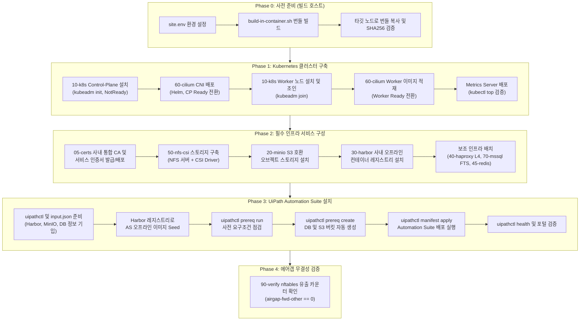

# offline-install — 에어갭 환경 Vanilla K8s 및 UiPath Automation Suite 오프라인 설치 가이드

인터넷에 연결되지 않은 완전 폐쇄망(Air-gapped) 환경의 Ubuntu 22.04 / 24.04 노드에 **Kubernetes v1.36.4** 클러스터를 구축하고, 그 위에 **UiPath Automation Suite(v2.2510.4)** 및 필수 인프라 서비스(NFS-CSI, MinIO, Harbor, HAProxy, MSSQL/PostgreSQL, Redis)를 단계별로 설치·운영하기 위한 종합 엔드투엔드 가이드입니다.

> [!NOTE]
> 저장소 루트의 `README.md`는 인터넷이 연결된 환경 기준의 온라인 설치 절차입니다.  
> 외부 인터넷 통신이 차단된 에어갭 환경에서는 반드시 이 문서의 오프라인 번들 기반 절차를 따라야 합니다.

---

## 1. 전체 아키텍처 및 단계별 설치 흐름

에어갭 환경의 구축은 단순 번호순이 아닌 엄격한 서비스 의존성에 따라 순차적으로 진행됩니다.



### 소프트웨어 버전 매트릭스

| 구성 요소 | 버전 | 유형 / 배포 방식 | 비고 |
|---|---|---|---|
| **OS** | Ubuntu 22.04 LTS / 24.04 LTS | Linux Host (amd64) | 10-k8s deb 빌드 시 OS 코드네임 일치 필수 |
| **Kubernetes** | **v1.36.4** | deb / kubeadm, containerd v2.3.5 | CRI: containerd (`SystemdCgroup = true`) |
| **CNI (Cilium)** | **v1.20.2** | Helm 차트 + 컨테이너 이미지 | VXLAN tunnel (UDP 8472), kube-proxy 유지 |
| **Metrics Server** | **v0.9.0** | K8s 애드온 Manifest | `--kubelet-insecure-tls` 적용 |
| **인증서 (PKI)** | Internal CA | `05-certs/make-certs.sh` | OpenSSL 기반 사내 통합 CA 및 서비스별 SAN 인증서 |
| **Storage (CSI)** | csi-driver-nfs **v4.13.4** | K8s CSI Driver + NFS Kernel Server | 기본 StorageClass: `nfs-csi` (동적 프로비저닝) |
| **Object Storage** | MinIO `RELEASE.2025-09-07` | Docker Compose (SNSD 단일 노드) | S3 호환, TLS 적용 |
| **Registry** | Harbor **v2.15.2** | 공식 오프라인 인스톨러 + systemd | HTTPS(443) 전용, 자동 복구 스크립트 |
| **L4 Load Balancer** | HAProxy **3.1** | Docker (`--network host`) | 80/443/15021 TCP 패스스루 |
| **Database** | SQL Server 2022 (CU25/CU26) / PostgreSQL 16 | Docker 커스텀 이미지 / Docker Compose | MSSQL은 **Full-Text Search(FTS)** 내장 필수, PG는 TLS 적용 |
| **Cache** | Redis OSS **7.4** | Docker Compose | TLS 활성화, 단일 노드 |
| **Automation Suite** | **v2.2510.4** | `uipathctl` 배포 | ArgoCD 기반 라이프사이클 관리 |

---

## 2. Phase 0: 사전 준비 (번들 빌드 및 사이트 설정)

오프라인 설치 번들은 인터넷이 되는 **빌드 호스트**에서 생성한 뒤, 에어갭 타깃 노드로 이관합니다.

### 2.1 사이트 환경 설정 ([`00-common/site.env`](file:///Users/hyungsoo.kim/Works/vanilla-k8s-as-install/offline-install/00-common/site.env))

사내 IP, 도메인, 스토리지 경로 등은 [`00-common/site.env`](file:///Users/hyungsoo.kim/Works/vanilla-k8s-as-install/offline-install/00-common/site.env) 파일에 정의합니다. 이 파일은 번들 생성 시 자동으로 포함됩니다.

```bash
cd offline-install/00-common
cp site.env.example site.env
vi site.env
```

**주요 설정 항목 요약:**
- `SITE_PRIVATE_CIDR`: 사내망 대역 (예: `10.32.99.0/24` 또는 `10.0.0.0/16`)
- `NFS_SERVER_HOST`: NFS 서버 호스트 IP (예: `10.32.99.4`)
- `NFS_MOUNT_PATH` / `NFS_EXPORT_PATH`: NFS 서버 마운트 및 export 디렉터리 (예: `/data/nfs`)
- `HARBOR_HOSTNAME` / `HARBOR_PRIVATE_IP`: 사내 Harbor FQDN 및 IP (예: `harbor.myrobots.co.kr` / `10.32.99.4`)
- `MINIO_HOSTNAME`: MinIO FQDN (예: `minio.myrobots.co.kr`)
- `AS_FQDN`: Automation Suite 서비스 FQDN (예: `as2510.myrobots.co.kr`, 하위 와일드카드 인증서 발급 대상)
- `MSSQL_DATA_DIR` / `MSSQL_SA_PASSWORD` / `MSSQL_PID`: 외부 MSSQL 데이터 경로, SA 암호 및 에디션
- `PG_DATA_DIR` / `PG_HOSTNAME` / `PG_PASSWORD`: 외부 PostgreSQL 데이터 경로(기본: `/data/postgresql`), 접속 FQDN 및 암호
- `REDIS_HOSTNAME` / `REDIS_PASSWORD` / `REDIS_PORT`: Redis 접속 FQDN, 패스워드 및 포트 (기본 6379)

### 2.2 컨테이너 환경에서 번들 빌드

깨끗한 호스트 환경을 보장하기 위해 rootless Podman 기반의 컨테이너 빌드를 권장합니다.

```bash
cd offline-install

# 1) 업스트림 다운로드 URL 생존 확인
./00-common/verify-urls.sh

# 2) 번들 빌드 실행 (Ubuntu 24.04 기준 전체 빌드)
./00-common/build-in-container.sh 24.04 all

# 특정 컴포넌트만 빌드할 경우 예시:
# ./00-common/build-in-container.sh 24.04 10-k8s 60-cilium 50-nfs-csi 30-harbor 20-minio
```

> [!IMPORTANT]
> `10-k8s` 번들은 OS 의존적(deb 패키지)이므로 타깃 노드와 동일한 Ubuntu 버전(22.04 또는 24.04)에서 빌드해야 합니다. 나머지 번들은 컨테이너 이미지와 정적 파일 중심이므로 공용으로 사용 가능합니다.

### 2.3 에어갭 타깃 노드로 번들 전송 및 검증

생성된 `.tar.gz` 아카이브와 `.sha256` 체크섬 파일을 타깃 노드로 복사하고 무결성을 확인합니다.

```bash
# 타깃 노드에서 무결성 검증
sha256sum -c k8s-1.36.4-noble.tar.gz.sha256
sha256sum -c cilium-1.20.2.tar.gz.sha256
sha256sum -c nfs-csi-v4.13.4.tar.gz.sha256
sha256sum -c harbor-v2.15.2.tar.gz.sha256
sha256sum -c minio-RELEASE.*.tar.gz.sha256
```

---

## 3. Phase 1: Kubernetes 클러스터 구축 (k8s Installation)

### 3.1 Control-Plane 노드 설치 ([`10-k8s`](file:///Users/hyungsoo.kim/Works/vanilla-k8s-as-install/offline-install/10-k8s/README.md))

Control-Plane 노드(예: `10.32.99.3`)에서 Kubernetes 기본 패키지, containerd 런타임, 정적 파드 이미지를 로드하고 `kubeadm init`을 실행합니다.

```bash
# Control-Plane 노드에서 실행
tar xzf k8s-1.36.4-noble.tar.gz
cd k8s-1.36.4-noble

# 단일 Control-Plane 설치
sudo ./install.sh

# HA 다중 Control-Plane 구성인 경우 (안정적인 VIP/LB 엔드포인트 지정 필수):
# sudo ./install.sh --control-plane-endpoint k8s-api.example.internal:6443
```

**설치 후 확인사항:**
```bash
export KUBECONFIG=/etc/kubernetes/admin.conf
kubectl get nodes
```
> [!NOTE]
> CNI가 아직 배포되지 않았으므로 노드 상태가 `NotReady`로 표시되는 것이 정상입니다.

---

### 3.2 Cilium CNI 설치 ([`60-cilium`](file:///Users/hyungsoo.kim/Works/vanilla-k8s-as-install/offline-install/60-cilium/README.md))

노드 간 네트워크 통신과 파드 간 라우팅을 활성화하기 위해 Control-Plane에서 Cilium CNI를 설치합니다.

```bash
tar xzf cilium-1.20.2.tar.gz
cd cilium-1.20.2

# Control-Plane에서 Helm 기반 CNI 설치 실행
sudo ./install.sh
```

**설치 검증:**
```bash
# 노드가 Ready 상태로 전환되었는지 확인
kubectl get nodes

# Cilium 파드 및 CoreDNS 정상 기동 확인
kubectl -n kube-system get pods -l k8s-app=cilium
kubectl -n kube-system get pods -l k8s-app=kube-dns
```

> [!WARNING]
> 오프라인 환경에서는 `docker-archive` tarball 임포트 시 이미지 다이제스트 매핑이 누락될 수 있으므로, [`60-cilium/conf/values.yaml`](file:///Users/hyungsoo.kim/Works/vanilla-k8s-as-install/offline-install/60-cilium/conf/values.yaml)에 `useDigest: false`가 반드시 유지되어야 합니다.

---

### 3.3 Worker 노드 설치 및 클러스터 조인 ([`10-k8s`](file:///Users/hyungsoo.kim/Works/vanilla-k8s-as-install/offline-install/10-k8s/README.md))

1. **Control-Plane 노드에서 조인 명령 발급:**
   ```bash
   sudo ./install.sh --print-join-command
   # 출력 예시: kubeadm join 10.32.99.3:6443 --token <TOKEN> --discovery-token-ca-cert-hash sha256:<HASH>
   ```

2. **Worker 노드(예: `10.32.99.4`)에서 조인 실행:**
   ```bash
   tar xzf k8s-1.36.4-noble.tar.gz
   cd k8s-1.36.4-noble

   sudo ./install.sh --role worker \
     --join-command "kubeadm join 10.32.99.3:6443 --token <TOKEN> --discovery-token-ca-cert-hash sha256:<HASH>"
   ```

---

### 3.4 Worker 노드 CNI 이미지 로드 ([`60-cilium`](file:///Users/hyungsoo.kim/Works/vanilla-k8s-as-install/offline-install/60-cilium/README.md))

Worker 노드가 클러스터에 조인되면 Cilium DaemonSet 파드가 스케줄링되지만, 폐쇄망에서는 이미지를 pull할 수 없어 `ImagePullBackOff`가 발생합니다. Worker 노드에서 CNI 이미지를 로컬 containerd에 미리 적재해야 합니다.

```bash
# Worker 노드에서 실행
cd ~/cilium-1.20.2
sudo ./install.sh --role worker
```

**클러스터 전체 노드 상태 확인 (Control-Plane에서 실행):**
```bash
kubectl get nodes -o wide
# 모든 노드가 Ready 상태이고 내부 IP가 정상 표시되는지 확인
```

---

### 3.5 Metrics Server 애드온 배포 ([`metrics-server`](file:///Users/hyungsoo.kim/Works/vanilla-k8s-as-install/metrics-server/components.yaml))

UiPath Automation Suite의 설치 사전 점검(`uipathctl prereq run`) 및 스케줄러 리소스 체크를 위해 Metrics Server가 필수적입니다.

```bash
# Control-Plane에서 components.yaml 적용
kubectl apply -f metrics-server/components.yaml

# 롤아웃 확인
kubectl -n kube-system rollout status deployment/metrics-server --timeout=120s
kubectl get apiservice v1beta1.metrics.k8s.io

# 노드 메트릭 수집 확인 (수집까지 약 30~60초 소요)
kubectl top nodes
```

---

## 4. Phase 2: Automation Suite 필수 인프라 구성 (Prerequisites / Infra Services)

Automation Suite 설치 전, 스토리지(NFS-CSI), 오브젝트 스토리지(MinIO), 사내 레지스트리(Harbor), 로드밸런서(HAProxy), 데이터베이스(MSSQL/PostgreSQL), 캐시(Redis)를 구성합니다.

### 4.1 사내 통합 CA 및 서비스 인증서 발급/배포 ([`05-certs`](file:///Users/hyungsoo.kim/Works/vanilla-k8s-as-install/offline-install/05-certs/README.md))

단일 사내 Root CA를 생성하여 모든 서비스의 TLS 인증서를 통합 발급하고, 각 노드가 상호 신뢰하도록 배포합니다.

```bash
# 1) 인증서 발급 (관리 호스트 또는 CP 노드)
cd offline-install/05-certs
./make-certs.sh

# 2) 발급된 인증서 확인
# out/as/ (AS 와일드카드 TLS)
# out/harbor/, out/minio/, out/mssql/, out/redis/, out/pgsql/

# 3) 클러스터 노드 및 인프라 서버에 CA 신뢰 배포
sudo ./deploy-certs.sh --target local
# 원격 노드로 배포 시:
# scp out/ca/ca.crt user@<노드>:~/ && sudo ./deploy-certs.sh --ca-only
```

---

### 4.2 NFS-CSI 동적 스토리지 구성 ([`50-nfs-csi`](file:///Users/hyungsoo.kim/Works/vanilla-k8s-as-install/offline-install/50-nfs-csi/README.md))

UiPath Automation Suite 파드들의 영구 볼륨(PVC)을 지원하기 위해 NFS 서버와 Kubernetes NFS CSI 드라이버를 구성합니다.

#### 4.2.1 NFS 서버 구성 (NFS 전용 호스트 또는 지정 노드)
```bash
cd offline-install/50-nfs-csi
# site.env 에 지정된 NFS_MOUNT_PATH(/data/nfs)를 기준으로 export 설정
sudo ./setup-nfs-server.sh
sudo ./setup-nfs-server.sh --check-only
```

#### 4.2.2 K8s 클러스터에 NFS CSI 드라이버 및 StorageClass 배포
```bash
# 1) Control-Plane 노드에서 드라이버 및 StorageClass 배포
cd ~/nfs-csi-v4.13.4
sudo ./install.sh

# 2) Worker 노드에서 nfs-common 및 드라이버 이미지 적재
cd ~/nfs-csi-v4.13.4
sudo ./install.sh --role worker
```

**검증:**
```bash
kubectl get storageclass
# nfs-csi (기본 default) 및 nfs-csi-retain 생성 확인
```
> [!TIP]
> `install.sh` 실행 시 자체적으로 임시 PVC/Pod를 생성하여 실제 볼륨 마운트 및 읽기/쓰기 테스트를 수행하고 자동 삭제합니다.

---

### 4.3 S3 호환 Object Storage 구성 (MinIO, [`20-minio`](file:///Users/hyungsoo.kim/Works/vanilla-k8s-as-install/offline-install/20-minio/README.md))

UiPath Orchestrator, Data Service, Test Automation 등의 패키지 아티팩트 및 대용량 파일 저장을 위해 MinIO를 배포합니다 (외부 AWS S3를 사용하지 않는 완전 온프레미스 에어갭 환경 기준).

```bash
tar xzf minio-RELEASE.*.tar.gz
cd minio-RELEASE.*

# MinIO 컨테이너 기동 (Docker Compose 기반, TLS 자동 적용)
sudo ./install.sh

# 상태 점검
sudo ./install.sh --check-only
```

- **엔드포인트:** `https://<MINIO_HOSTNAME>:9000` (콘솔: 9001)
- **자격증명 확인:** `/opt/minio/minio.env`
- **Automation Suite용 버킷 생성:** MinIO Client(`mc`) 또는 웹 콘솔에서 AS 설치에 사용할 버킷(예: `charles-as-bucket` 또는 `uipath`)을 사전 생성합니다.

---

### 4.4 오프라인 컨테이너 레지스트리 구성 (Harbor, [`30-harbor`](file:///Users/hyungsoo.kim/Works/vanilla-k8s-as-install/offline-install/30-harbor/README.md))

UiPath Automation Suite의 컨테이너 이미지와 Helm 차트를 폐쇄망 내부에서 제공할 사내 프라이빗 레지스트리를 설치합니다.

```bash
tar xzf harbor-v2.15.2.tar.gz
cd harbor-v2.15.2

# Harbor 설치 및 자동 복구 systemd 서비스 등록
sudo ./install.sh

# 기동 상태 및 재부팅 복구 검증
sudo ./install.sh --check-only
sudo ./install.sh --test-restart
```

**설치 후 작업:**
1. 웹 브라우저 또는 CLI에서 `https://<HARBOR_HOSTNAME>` 접속 (`admin` / `site.env`에 지정된 패스워드 또는 자동생성값)
2. Automation Suite 이미지를 저장할 신규 프로젝트 생성: `uipath` (Public으로 설정하거나 Pull Secret 연동 준비)
3. 모든 K8s 노드 및 워커에서 Harbor 인증서 신뢰 상태 확인 (`docker login <HARBOR_HOSTNAME>`)

---

### 4.5 보조 필수 인프라 서비스 구성

| 구성 요소 | 디렉터리 | 주요 역할 및 구성 요령 |
|---|---|---|
| **L4 Load Balancer** | [`40-haproxy`](file:///Users/hyungsoo.kim/Works/vanilla-k8s-as-install/offline-install/40-haproxy/README.md) | 호스트의 `80`, `443`, `15021` 포트를 인그레스 게이트웨이 NodePort로 패스스루 (`--network host`, `--restart unless-stopped`). Worker 노드에는 설치하지 않음. |
| **SQL Server** | [`70-mssql`](file:///Users/hyungsoo.kim/Works/vanilla-k8s-as-install/offline-install/70-mssql/README.md) | **Full-Text Search(FTS)**가 내장된 커스텀 이미지(`mssql-fts:2022`) 필수 실행. 공식 MS 이미지에는 FTS가 없어 AS 설치 실패. 포트 1433. |
| **PostgreSQL** | [`80-postgresql`](file:///Users/hyungsoo.kim/Works/vanilla-k8s-as-install/offline-install/80-postgresql/README.md) | PostgreSQL 16 컨테이너, TLS 적용, 포트 5432 (Data Service 등 요구 시). |
| **Redis Cache** | [`45-redis`](file:///Users/hyungsoo.kim/Works/vanilla-k8s-as-install/offline-install/45-redis/README.md) | Redis OSS 단일 노드 (TLS 리스너, 포트 6379, 데이터 디렉터리 `/data/redis`). |

---

## 5. Phase 3: UiPath Automation Suite 오프라인 설치 (Automation Suite Installation)

모든 하부 인프라(K8s, CNI, NFS-CSI, MinIO, Harbor, DB, LB)가 정상 동작하는 상태에서 UiPath Automation Suite 설치를 진행합니다.

### 5.1 설치 바이너리 및 입력 매니페스트 준비

1. **`uipathctl` 바이너리 배치:**
   ```bash
   chmod +x ./uipathctl
   sudo cp ./uipathctl /usr/local/bin/
   uipathctl version
   ```

2. **환경 매니페스트 작성 (`input.json`):**
   저장소의 [`input-myrobot.json`](file:///Users/hyungsoo.kim/Works/vanilla-k8s-as-install/input-myrobot.json)을 템플릿으로 복사하여 실제 사내 에어갭 환경에 맞게 수정합니다.

   > [!IMPORTANT]
   > **단일 Control-Plane(Single CP) 환경의 Profile 설정 가이드:**
   > - **최상위 루트 `profile`**: 반드시 `"default"`로 유지합니다. (단일 Control-Plane 환경에서는 플랫폼 인프라/Fabric 컴포넌트가 단일 노드 스펙에 적합하게 배치되도록 루트 레벨은 `"default"`를 유지해야 합니다.)
   > - **개별 앱(App)별 `profile`**: 각 애플리케이션(`orchestrator`, `dataservice`, `integrationservices`, `studioweb` 등)마다 `"profile": "lite"`로 설정합니다. 이를 통해 한정된 클러스터 리소스 환경에서 파드 레플리카 수와 CPU/메모리 요구량을 최소화할 수 있습니다.

   ```json
   {
     "registries": {
       "docker": { "url": "harbor.myrobots.co.kr/uipath" },
       "helm": { "url": "harbor.myrobots.co.kr/uipath" }
     },
     "fqdn": "as2510.myrobots.co.kr",
     "profile": "default",
     "namespace": "uipath",
     "fabric": {
       "redis": {
         "hostname": "10.32.99.3",
         "port": 6379,
         "password": "<REDIS_PASSWORD>",
         "tls": true
       }
     },
     "external_object_storage": {
       "enabled": true,
       "storage_type": "s3",
       "fqdn": "minio.myrobots.co.kr",
       "port": 9000,
       "access_key": "<MINIO_ACCESS_KEY>",
       "secret_key": "<MINIO_SECRET_KEY>",
       "region": "us-east-1",
       "create_bucket": true
     },
     "sql": {
       "create_db": true,
       "server_url": "10.32.99.4",
       "port": "1433",
       "username": "sa",
       "password": "<MSSQL_PASSWORD>"
     },
     "orchestrator": {
       "enabled": true,
       "profile": "lite",
       "external_object_storage": { "bucket_name": "charles-as-bucket" }
     },
     "dataservice": {
       "enabled": true,
       "profile": "lite",
       "external_object_storage": { "bucket_name": "charles-as-bucket" }
     },
     "integrationservices": {
       "enabled": true,
       "profile": "lite",
       "external_object_storage": { "bucket_name": "charles-as-bucket" }
     },
     "studioweb": {
       "enabled": true,
       "profile": "lite",
       "external_object_storage": { "bucket_name": "charles-as-bucket" }
     }
   }
   ```

---

### 5.2 오프라인 이미지를 Harbor 레지스트리에 적재 (Image Seeding)

UiPath 다운로드 포털에서 확보한 Automation Suite 오프라인 이미지 번들(tar 파일들)을 사내 Harbor 레지스트리에 일괄 업로드합니다.

```bash
# Harbor로 이미지 및 헬름 차트 일괄 푸시
uipathctl registry seed \
  --tar-file /path/to/uipath-images.tar \
  --dest-registry harbor.myrobots.co.kr/uipath \
  --dest-username admin \
  --dest-password "<HARBOR_ADMIN_PASSWORD>" \
  --num-worker 4
```

---

### 5.3 사전 요구조건 점검 (Prerequisites Check)

설치 실행 전, 클러스터 리소스, DNS, 스토리지 클래스, 외부 DB 및 Object Storage의 연결성을 자동 검증합니다.

```bash
uipathctl prereq run input.json --versions versions.json
```

**주요 점검 항목:**
- 노드 CPU/메모리 사양 및 Metrics Server 응답 상태
- 기본 StorageClass(`nfs-csi`) 바인딩 가능 여부
- SQL Server 접속 및 Full-Text Search 지원 여부
- MinIO S3 API 엔드포인트 도달 및 인증 여부
- Harbor 레지스트리 이미지 pull 가능 여부

---

### 5.4 외부 사전 리소스 자동 생성

데이터베이스(DB)와 오브젝트 스토리지 버킷을 사전에 자동으로 생성합니다.

```bash
uipathctl prereq create input.json --versions versions.json
```

---

### 5.5 Automation Suite 배포 실행

모든 사전 점검을 통과하면 실제 클러스터 배포를 시작합니다.

```bash
# 1) 드라이런으로 배포 내용 사전 확인 (선택 사항)
uipathctl manifest apply --dry-run input.json --versions versions.json

# 2) 실제 배포 실행
uipathctl manifest apply input.json --versions versions.json
```

배포가 시작되면 ArgoCD 애플리케이션들이 순차적으로 생성되고 파드들이 기동됩니다.
```bash
# 파드 기동 상태 모니터링
kubectl -n uipath get pods -w
```

---

### 5.6 설치 완료 검증 및 헬스체크

배포가 완료되면 플랫폼의 전반적인 상태를 검증합니다.

```bash
# 1) 컴포넌트 헬스체크 실행
uipathctl health

# 2) 인그레스 게이트웨이 및 노드포트 상태 확인
kubectl -n istio-system get svc istio-ingressgateway
```

3. **웹 브라우저 접속 테스트:**
   - 관리자 PC의 `hosts` 파일에 `as2510.myrobots.co.kr` (HAProxy IP) 등록
   - `https://as2510.myrobots.co.kr` 접속 후 초기 로그인 (`admin` / 설정한 초기 암호)

---

## 6. Phase 4: 에어갭 무결성 검증 및 운영 관리

### 6.1 에어갭 네트워크 완전성 검증 ([`90-verify`](file:///Users/hyungsoo.kim/Works/vanilla-k8s-as-install/offline-install/90-verify/README.md))

설치 과정 중 클러스터가 외부 인터넷으로 패킷을 유출하거나 누락된 패키지를 외부에서 다운로드하려 하지 않았는지 `nftables` 카운터로 검증합니다.

```bash
# 1) 인터넷 차단 활성화 (설치 시작 전)
sudo ./90-verify/airgap-on.sh

# 2) 설치 완료 후 차단 해제 및 유출 카운터 판정
sudo ./90-verify/airgap-off.sh
```

**판정 기준:**
- `airgap-fwd-other == 0`: 파드가 인터넷 외부로 직접 통신을 시도한 횟수가 0이어야 함 (**완전 오프라인 설치 입증**)
- `airgap-*-noise != 0`: 내부 DNS/NTP 통신 등은 정상 소음으로 분류됨

---

### 6.2 주요 트러블슈팅 가이드

| 증상 | 원인 | 해결 조치 |
|---|---|---|
| **Cilium Pod `ImagePullBackOff`** | `docker-archive` tar 로드 시 sha256 다이제스트가 유실됨 | [`60-cilium/conf/values.yaml`](file:///Users/hyungsoo.kim/Works/vanilla-k8s-as-install/offline-install/60-cilium/conf/values.yaml)에서 `image.useDigest: false` 설정 확인 후 재배포 |
| **Worker 노드가 영구 `NotReady`** | Worker 노드에 Cilium CNI 컨테이너 이미지가 적재되지 않음 | Worker 노드에서 `sudo ./60-cilium/install.sh --role worker` 실행 |
| **PVC 상태가 `Pending` 또는 마운트 실패 (`Operation not permitted`)** | NFS export 옵션에 `insecure`가 없거나 StorageClass에 `noresvport`가 누락/충돌됨 | NFS 서버의 `/etc/exports`에 `insecure` 추가, StorageClass 삭제 후 `mountOptions` 재확인 및 재생성 |
| **Harbor 재부팅 후 443 접속 불가 (`Connection refused`)** | Docker 데몬이 컨테이너 순서(`harbor-log`의 1514 포트 리스너 준비)를 기다리지 않고 동시 기동함 | `sudo systemctl restart harbor.service` 실행 ([`30-harbor/conf/harbor-start.sh`](file:///Users/hyungsoo.kim/Works/vanilla-k8s-as-install/offline-install/30-harbor/conf/harbor-start.sh) 순차 기동 보장) |
| **MSSQL 사전 점검 실패 (`Full-Text Search not installed`)** | MS 공식 mssql 이미지를 사용하여 FTS 서비스가 누락됨 | [`70-mssql/fts-image`](file:///Users/hyungsoo.kim/Works/vanilla-k8s-as-install/offline-install/70-mssql/fts-image)에서 빌드된 `mssql-fts:2022` 이미지로 교체 |
| **`kubectl top nodes` 메트릭 수집 불가** | Metrics Server의 kubelet serving 인증서 검증 실패 | [`metrics-server/components.yaml`](file:///Users/hyungsoo.kim/Works/vanilla-k8s-as-install/metrics-server/components.yaml)에 `--kubelet-insecure-tls` 및 `--kubelet-preferred-address-types=InternalIP` 플래그 추가 |

---

### 6.3 클러스터 중지 및 재기동 순서

NFS StorageClass에 `hard` 마운트 옵션이 적용되어 있으므로 반드시 스토리지 의존성 순서에 따라 정지/기동해야 I/O 교착 상태를 방지할 수 있습니다.

```
[클러스터 중지 순서]
Worker 노드 중지  ──>  Control-Plane 노드 중지  ──>  NFS / 스토리지 / DB 서버 중지

[클러스터 시작 순서]
NFS / 스토리지 / DB 서버 시작  ──>  Control-Plane 노드 시작  ──>  Worker 노드 시작
```
